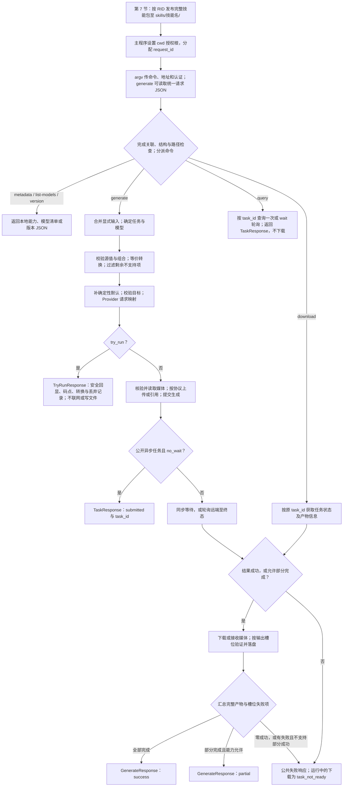

# 图片/视频技能 CLI 统一架构与协议方案

本文为待实现的策划契约，适用于 `src/Multimedia/` 内的图片、视频技能 CLI。按命名、命令与输入、响应字段、退出码、任务生命周期、契约一致性、技能发布、流程图的顺序组织；不代表业务或发布能力已实现。

## 1. 命名规范

| 对象 | 规范 | 示例 | 说明 |
| --- | --- | --- | --- |
| 可执行程序 / 技能 ID | `skill-<provider>-<capability>` | `skill-openai-image` | 小写 kebab-case；无扩展名程序名、`skill_id`、发布清单 `skill_name`、技能目录名和 `SKILL.md` 的 YAML `name` 一致；Windows 的 `.exe` 不属于 ID。 |
| `<provider>` | 稳定的厂商或平台标识 | `openai`、`aliyun`、`kuaishou`、`minimax` | 使用官方英文名或稳定品牌名；同一厂商不得为不同技能改用不同拼写。 |
| `<capability>` | `image`、`video` 或 `image-video` | `skill-kuaishou-video` | 表示技能支持的生成媒体类型；双能力技能使用 `image-video`。 |
| 命令 | 小写 kebab-case | `list-models` | 固定命令名，不使用厂商专有别名替代。 |
| 选项 | 长选项、小写 kebab-case | `--request-file` | 共用字段使用本方案名称；协议专用直接参数用 `--provider-<provider>-<name>`，请求文件内按 Provider 命名空间组织。 |
| JSON 字段 | `snake_case` | `request_id` | 公共 JSON 字段使用 snake_case；Provider 原始请求预览及嵌入的 JSON Schema 保留各自字段名，不能据此扩展公共根字段。 |
| 项目 / 命名空间 | `Madorin.AI.<Provider>.<Capability>` | `Madorin.AI.OpenAI.Image` | `<Provider>` 使用 PascalCase；能力段使用 `Image`、`Video` 或 `ImageVideo`。 |
| 产物文件 | `<type>_<sequence>.<ext>` | `image_001.png` | 落盘序号从 `001` 开始；冲突时递增且不覆盖，与请求 `index` 是独立概念；扩展名与实际格式一致。 |

## 2. 命令契约

可执行文件通过 argv 接收命令、文件路径及少量直接参数。生成内容支持统一 JSON 请求文件；API 地址、密钥和其他认证材料只通过直接参数传入，不写入请求文件，不使用 AES 或连接配置文件。stdout 仅输出一个 UTF-8 JSON 对象；诊断和进度写入 stderr。生成参数先按第 2.7 节转换，确实无法应用的再按第 2.8 节丢弃。请求与响应关联按第 3.0 节执行。

| 命令 | 语法 | 成功结果 | 说明 |
| --- | --- | --- | --- |
| `metadata` | `<skill> metadata --request-id <id>` | `SkillMetadata` JSON | 返回技能身份、能力、命令及参数定义；供宿主发现与验证技能。 |
| `list-models` | `<skill> list-models --request-id <id> [--output-format json]` | `ModelList` JSON | 列出该技能可用的图片或视频模型及能力；不能返回不支持生成的通用模型。 |
| `generate` | 文件：`<skill> generate --request-file <file> [options]`；直接：`<skill> generate --request-id <id> [options]` | `GenerateResponse`；试运行为 `TryRunResponse`；异步提交为 `TaskResponse` | 请求 ID 至少由文件或 argv 一处提供，双来源须相同；其他显式直接参数可覆盖文件。等待落盘时须提供输出目录，仅提交异步任务时可省略。 |
| `query` | `<skill> query --request-id <id> --task-id <task> [--api-url <uri>] [--api-key <key>] [--wait] [--timeout <seconds>]` | `TaskResponse` JSON | 异步技能提供；默认查询一次，`--wait` 等待远端终态。不重新提交生成、不下载媒体，不要求请求文件。 |
| `download` | `<skill> download --request-id <id> --task-id <task> --output-dir <path> [--api-url <uri>] [--api-key <key>] [--timeout <seconds>]` | `GenerateResponse` JSON | 异步技能提供；按任务 ID 获取已完成产物并落盘，不创建新的生成任务，不要求请求文件。 |
| `version` | `<skill> version --request-id <id>` | `VersionInfo` JSON | 返回技能 CLI 版本、协议契约版本及构建信息。 |

每次调用必须携带主程序分配的 `request_id`；生成文件内可提供，直接模式及查询类命令用 `--request-id`。每个已识别有效 ID 的响应顶层 `response_id` 必须与之原样相同，不能用远端任务 ID 替代。API 地址省略时使用技能声明的默认端点；没有默认端点才要求提供。密钥是否必需取决于认证声明。主程序用独立 argv 值启动 CLI，不记录完整含密钥命令；CLI 不持久化凭证，回显固定脱敏。此约定不保证对有权限读取进程参数的程序隐藏密钥。

### 2.1 通用选项

| 选项 | 类型 | 必需 | 默认值 | 约束与含义 |
| --- | --- | --- | --- | --- |
| `--request-file` | 文件路径 | 文件输入模式必需 | 无 | 指向第 2.3 节的 UTF-8 JSON 请求文件，不能传目录；生成的原有直接参数模式继续保留。 |
| `--request-id` | 字符串 | 合并后必需 | 无 | 主程序生成的本次调用 ID；所有命令接受。生成文件已有 `request_id` 时可省略；两处均提供时必须相同，不能按普通覆盖规则替换。格式与异常处理见第 3.0 节。 |
| `--api-url` | URI | 由 Provider 声明 | metadata 声明；无声明则无默认 | Provider API 基础地址或端点地址；只允许 HTTPS，除非 Provider 明确支持本地 HTTP 服务。必需性及路径拼接由 Provider 确定。 |
| `--api-key` | 字符串 | 是\* | 无 | 认证凭证。`*` 表示 API Key 认证的 Provider 必需；无 API Key 的认证方式由 Provider metadata 声明。 |
| `--prompt` | 字符串 | 文生图/文生视频必需 | 无 | 生成指令；原样作为用户输入映射，不隐式翻译或改写。图生视频、编辑等模式按 Provider 的模式约束决定是否必需。 |
| `--output-dir` | 路径 | 生成等待落盘或下载时必需 | 无 | 可由请求文件 `execution.output_dir` 提供；直接传参优先。产物路径相对于此目录。仅提交异步任务和查询状态时不要求提供。 |
| `--model` | 字符串 | 条件必需 | 按第 2.2 节选择 | 必须是 `list-models` 中支持所选任务的模型 ID；不能以显示名、清单顺序或远端临时默认值代替。 |
| `--task` | 字符串枚举 | 条件必需 | 按第 2.2 节选择 | 本次生成任务 ID；即使技能同时支持图片和视频，一次调用也只执行一个任务、输出一种媒体。 |
| `--timeout` | 正整数秒 | 否 | `300` | 提交、轮询和下载的业务时限；到期停止生成工作，终态为 `timeout`。可额外取消清理最多 `5` 秒，宿主等待应预留该宽限，详见第 5 节。 |
| `--output-format` | 枚举 | 否 | `json` | `json` 输出单个终态 JSON 对象；流式行输出如未由本契约扩展，不得自行改变 stdout 格式。 |
| `--verbose` | 布尔开关 | 否 | `false` | 增加 stderr 诊断信息；不得改变请求参数、stdout JSON 或产物内容。不得输出密钥、签名 URL 或提示词。 |
| `--try-run` | 布尔开关 | 否 | `false` | 执行与正常模式相同的本地参数解析、校验和 Provider 请求映射；不联网、不读媒体内容、不创建目录或文件。远端检查与文件实际可读写性不属于通过保证。 |
| `--attachment` | 可重复 JSON 对象 | 否 | 无 | 直接参数模式的统一附件入口，每次提供第 2.3 节的一个附件对象；合并为附件数组。原有参考图、源图和首尾帧选项作为其简写继续保留。 |
| `--no-wait` | 布尔开关 | 否 | `false` | 仅提交异步生成，取得任务 ID 后返回 `submitted`；模型任务须声明 `supports_async=true`。同步任务的有效值为 `true` 时报错，默认或显式 `false` 均正常。 |
| `--task-id` | 非空字符串 | 查询、下载必需 | 无 | 先前提交所得的远端任务 ID；使用原技能、原端点和有权限的凭证，不可跨 Provider 复用。 |
| `--wait` | 布尔开关 | 否 | `false` | 仅用于 `query`；在本次超时内轮询至远端终态，仍只查询，不下载或重新生成。 |

| 参数适用范围 | 选项 |
| --- | --- |
| 每个命令 | `--request-id`、`--output-format`、`--verbose`；认证只在命令声明需要时检查，本地元数据、模型清单和版本不要求认证。 |
| 生成 | `--request-file`、`--prompt`、`--task`、`--model`、`--attachment`、附件简写、通用及 Provider 生成参数、`--try-run`、`--no-wait`。 |
| 生成、查询、下载 | `--api-url`、认证参数、`--timeout`。生成和下载接受 `--output-dir`；查询不接受输出目录。 |
| 查询、下载 | `--task-id`；`--wait` 仅用于查询。向不适用命令传选项返回 `invalid_parameter`，不作为生成参数丢弃。 |

| argv 解析项 | 统一规则 |
| --- | --- |
| 传值 | 非布尔选项接受 `--name <value>` 或 `--name=<value>`，不接受未声明的缩写或位置参数；以 `--` 开头的值使用等号形式避免歧义。宿主使用独立 argv 元素，不拼接 Shell 命令。 |
| 布尔 | 裸 `--name` 为 `true`；显式值使用 `--name=true` 或 `--name=false`，仅接受小写 JSON 字面量。不使用 `--name false` 或自动生成反向选项；显式 `false` 可覆盖文件中的 `true`。 |
| 整数 | 使用十进制整数词法，不接受小数点、指数、千位分隔符或区域格式；JSON 文件的整数项遵循同一词法。数值按参数范围校验，不允许截断或溢出。 |
| 数值 | 使用 JSON 数字词法，十进制小数点为 `.`，允许指数；与系统区域设置无关。NaN、无穷、非有限转换结果及超出声明范围均失败。 |
| 复杂值与重复 | 对象、数组值使用严格 JSON；可重复选项的表中类型表示单次取值，metadata 声明整体为数组并定义 `items`。未声明可重复的选项重复时失败。 |
| 错误 | 缺值、非法词法、未知选项返回 `invalid_parameter`；受支持或可转换项继续校验业务类型和范围，最终不支持项的丢弃边界见第 2.8 节。 |

### 2.2 任务与模型

任务与模型按顺序确定；不能唯一确定时返回 `invalid_parameter`，试运行返回 `invalid`。

| 选择项 | 优先级与校验 |
| --- | --- |
| 任务 | 合并后的显式 `task` → `metadata.default_task` → 候选任务唯一时自动选择；显式指定模型时只考虑该模型任务，否则考虑技能全部任务。不从提示词或选项组合猜任务。默认任务与显式模型不兼容时直接报错。 |
| 模型 | 合并后的显式 `model` → `metadata.default_models[task]` → 支持该任务的模型唯一时自动选择；候选不唯一且无默认时要求显式指定。 |
| 选择结果 | 将确定的 `task`、`model` 写入有效参数；`validated` 不能携带未确定的任务或模型。 |

| 任务 ID | 媒体类型 | 主要输入与语义 |
| --- | --- | --- |
| `text-to-image` | `image` | 提示词必需；文本生成图片。 |
| `image-edit` | `image` | 参考图必需；是否还需提示词由该模型任务声明。 |
| `text-to-video` | `video` | 提示词必需；文本生成视频。 |
| `image-to-video` | `video` | 至少一张模型支持的源图、参考图或单首帧必需；允许的角色、数量和组合由任务 Schema 声明，提示词按任务要求。 |
| `first-last-frame` | `video` | 首帧、末帧均必需；按两帧约束生成视频。 |

技能只声明实际支持的任务；单首帧输入属于 `image-to-video` 的具体参数形式，不冒充首尾帧任务。其他任务 ID 作为契约扩展另行定义，不用自由字符串替代既有任务含义。

### 2.3 统一生成请求文件

文件输入与直接参数输入最终转换为同一个显式类型对象，共用转换、过滤、默认值、校验及 Provider 映射。请求文件描述主程序关联 ID、生成内容和执行设置，不保存连接凭证。

| 请求根字段 | 类型 | 必需 / 默认 | 含义 |
| --- | --- | --- | --- |
| `schema_version` | 字符串 | 是，初版 `1.0` | 统一请求格式版本；未知版本失败，不把版本当作可丢弃生成参数。 |
| `request_id` | 字符串 | 与 `--request-id` 至少一处提供 | 主程序分配的调用关联 ID，格式与双来源一致性按第 3.0 节；不是远端任务或幂等键。 |
| `task` | 字符串 | 按第 2.2 节选择 | 单次生成任务；不支持的任务失败，不自动换成其他任务。 |
| `model` | 字符串 | 可省略 | 目标技能的实际模型 ID；跨 CLI 通用文件宜省略并使用各技能默认模型。显式指定且不支持时失败，不丢弃路由选择。 |
| `prompt` | 字符串 | 按任务要求 | 完整提示词，保留中文、换行和顺序，不截断、不隐式改写。 |
| `attachments` | 附件数组 | `[]` | 参考图、源图、首尾帧等输入，按下表定义；数组顺序保留，不自动解释成视频时间轴。 |
| `parameters` | 对象 | `{}` | 通用生成参数；优先按第 2.7 节转换，无等价用法再丢弃。提示词、附件及执行控制不重复放此处。 |
| `provider_parameters` | 对象 | `{}` | `<provider>` 到专用参数对象的映射；先尝试已声明的跨 Provider 转换，无法理解或无法等价转换的剩余项再丢弃，不将原字段直接透传给其他供应商。 |
| `execution` | 对象 | `{}` | 执行控制，见下表；不是可随意丢弃的生成选项。 |

| `execution` 字段 | 类型 | 默认 / 约束 | 含义 |
| --- | --- | --- | --- |
| `output_dir` | 路径字符串 | 等待落盘时必需 | 本次产物目录，优先采用直接 `--output-dir`。 |
| `timeout` | 正整数秒 | `300` | 同 `--timeout`，业务时限与取消清理规则不变。 |
| `no_wait` | 布尔值 | `false` | 同 `--no-wait`；异步提交后返回任务 ID。 |
| `try_run` | 布尔值 | `false` | 同 `--try-run`；外部直接开关可将文件中的 `false` 覆盖为 `true`。 |
| `verbose` | 布尔值 | `false` | 同 `--verbose`；试运行的 stderr 约束优先。 |
| `output_format` | 枚举 | `json` | 初版仅 JSON，不能改变响应结构或将凭证写入文件。 |

| 附件字段 | 类型 | 必需 | 含义与约束 |
| --- | --- | --- | --- |
| `id` | 非空字符串 | 是 | 请求内唯一标识，过滤前检查重复；提示词可据此描述附件用途，不进行隐式文本替换。 |
| `role` | 枚举 | 是 | `reference` 通用参考图、`source` 图生视频源图、`first_frame` 首帧、`last_frame` 末帧；所选任务声明支持的角色。 |
| `source` | 对象 | 是 | 恰有 `path` 或 `uri` 一个非空字符串字段；不接受目录、两者并存、base64 或嵌套请求文件。附件及 `source` 未知字段属于协议结构错误。 |
| `source.path` | 字符串 | 与 `uri` 二选一 | 本地文件路径；请求文件内相对路径以请求文件所在目录为基准。 |
| `source.uri` | 字符串 | 与 `path` 二选一 | 远端 HTTPS 媒体地址；若为临时签名媒体地址，调用方负责有效期，诊断与试运行按敏感 URI 遮蔽且不生成码点。它不是可替代命令行 API 认证的配置来源。 |

| 文件处理项 | 统一规则 |
| --- | --- |
| 编码与格式 | UTF-8，可接受并移除开头 BOM；一个 JSON 对象，拒绝非法 UTF-8、重复键、注释和尾逗号。具体请求大小及提示词上限由 metadata 声明，超限不截断。 |
| 凭证边界 | 请求文件根部、执行项、生成参数及 Provider 扩展不得携带 API 地址、API Key 或其他认证配置；这些保留给命令行。发现约定的认证字段须拒绝且不回显值，不将其视为可忽略项。 |
| 支持项解析 | argv 保留来源和取值边界；原生支持或有转换规则的生成项必须解析并校验源值，不能因解析失败改为丢弃。确实无法支持且无转换规则的项才跳过业务解析。JSON 结构、关联 ID、凭证边界及路径授权不能被覆盖绕过。 |
| 授权根 | 启动时的进程工作目录 cwd 即本次调用的授权根，由宿主设置且调用期间固定；手动调用同样采用启动 cwd。请求文件所在目录只决定相对路径基准，不扩大授权范围。 |
| 路径解析 | 请求文件路径和 argv 本地路径相对启动 cwd；文件中的附件及输出路径相对请求文件目录。请求文件本身须先校验路径再读取；本地引用及输出路径也须规范化并解析现存祖先的符号链接或重解析点，按路径组件判断等于授权根或位于其内，不能只比较字符串前缀。越界返回 `invalid_parameter`。 |
| 路径访问 | 正式读取媒体、创建目录和写文件前重新核对边界，防止链接变化；试运行可查询路径及链接元数据，但不读取媒体字节或验证实际读写权限。 |
| 覆盖 | 直接参数按显式字段覆盖文件值，不以默认值覆盖；对象参数和附件数组整体替换。`request_id` 是例外：双来源值必须相同。某路径源于文件则采用文件目录基准，源于 argv 则采用当前工作目录。 |
| 附件简写 | 可重复 `--reference-image` 转成 `reference` 数组项；`--image-url`、`--first-frame-url`、`--last-frame-url` 分别映射对应角色。简写按 argv 顺序生成 `attachment_001` 起的稳定 ID；不能同时混用 `--attachment` 与简写，不能在文件 `parameters` 中再重复这些附件选项。 |
| 媒体处理 | 正式执行时由 Provider 读取并按协议上传、引用或编码；不能把本机路径当作远端可访问 URL。试运行只读取请求 JSON，不读取附件媒体、不上传、不联网。 |
| 形式统一 | 支持项保留原始语义：`prompt` 写根字段、媒体输入写 `attachments`、生成选项写 `parameters`、控制项写 `execution`。同一请求无论来自文件或 argv，Provider 收到同一有效类型；直接参数模式内部补 `schema_version=1.0`。 |
| 统一回显 | 使用请求根字段结构，再附加直接传入的 `request_file`、`api_url`、已脱敏凭证及其他路由选项。`input_parameters` 不含自动默认值，直接参数模式合成的请求版本仅放有效参数；`effective_parameters` 保留生效字段与默认值。路径保持来源写法，不回显内部解析所得本机绝对路径；调用方显式传入的路径按普通参数回显。 |

`./requests/job.json` 示例（示意技能支持两张参考图生成视频；生成图片可改为支持多图的 `image-edit` 任务并使用对应参数）：

```json
{
  "schema_version": "1.0",
  "request_id": "req-20261020-001",
  "task": "image-to-video",
  "prompt": "一只戴着红围巾的猫，在雪地里看着镜头",
  "attachments": [
    { "id": "front", "role": "reference", "source": { "path": "./images/front.png" } },
    { "id": "side", "role": "reference", "source": { "path": "./images/side.png" } }
  ],
  "parameters": { "duration": 5, "style": "cinematic" },
  "execution": { "output_dir": "./artifacts", "timeout": 300 }
}
```

### 2.4 图片参数

下列共用生成参数同时支持 argv 和请求文件 `parameters`，参数名去掉 `--` 并将连字符改为下划线；提示词与附件使用文件专门字段。当前协议字段不同不等于不支持：优先按第 2.7 节转换为当前模型可用参数，确实无等价用法再丢弃。已支持或可转换项的非法源值及冲突仍报错；未知 argv 选项因无法确定取值边界而报错。

| 选项 | 类型 | 默认值 | 互斥 / 约束 | 含义 |
| --- | --- | --- | --- | --- |
| `--width` | 正整数像素 | Provider 默认 | 与 `--height` 成对；尺寸归一见第 2.7 节 | 期望图片宽度，固定尺寸映射须等价，不能默默换尺寸。 |
| `--height` | 正整数像素 | Provider 默认 | 与 `--width` 成对；尺寸归一见第 2.7 节 | 期望图片高度。 |
| `--size` | 字符串 | Provider 默认 | 归一后与其他尺寸控制方式互斥 | 支持的具体尺寸标识，如 `1024x1024`；允许值由任务声明。 |
| `--aspect-ratio` | 比例字符串 | Provider 默认 | 归一后与其他尺寸控制方式互斥 | 如 `16:9`；没有明确像素或模型固定映射时不得猜尺寸。 |
| `--num-images` | 正整数 | `1` | 范围由模型 metadata 声明 | 请求生成数量；一次响应的产物数量不应超过该值。 |
| `--quality` | 字符串枚举 | Provider 默认 | 取值由模型 metadata 声明 | 生成质量档位，例如 `standard`、`hd`；不是所有 Provider 都使用相同档位。 |
| `--seed` | 整数 | 随机 | 优先转换，无法应用再丢弃 | 随机种子。未应用时不得声称已使用；预检不自行生成随机种子。 |
| `--style` | 字符串 | Provider 默认 | 取值由模型 metadata 声明 | 模型支持的风格预设 ID；不接受未声明值。 |
| `--negative-prompt` | 字符串 | 无 | 优先转换，无法应用再丢弃 | 描述应避免的内容；不通过拼入正向提示词假装等价支持。 |
| `--reference-image` | URI 或本地路径 | 无 | 支持参考图的模型可用 | 作为图像参考输入。协议需要多张时允许重复该选项；路径访问范围须由宿主限制在调用工作目录中。 |
| `--reference-weight` | 浮点数 | Provider 默认 | 范围 `0` 到 `1`；必须同时存在参考图 | 控制参考图对结果的影响程度；仅在模型支持时接受。 |
| `--guidance-scale` | 有限正浮点数 | Provider 默认 | 范围由模型 metadata 声明 | 控制生成对提示词的遵循程度；仅在模型支持时接受。 |
| `--steps` | 正整数 | Provider 默认 | 范围由模型 metadata 声明 | 生成推理步数；仅在模型支持时接受。 |

### 2.5 视频参数

| 选项 | 类型 | 默认值 | 互斥 / 约束 | 含义 |
| --- | --- | --- | --- | --- |
| `--image-url` | URI 或本地路径 | 无 | 与帧输入按 Provider 模式约束 | 图生视频的源图片；使用本地文件时必须受宿主工作目录边界约束。 |
| `--first-frame-url` | URI 或本地路径 | 无 | 若 Provider 要求首尾帧，则与 `--last-frame-url` 成对 | 视频首帧输入。 |
| `--last-frame-url` | URI 或本地路径 | 无 | 生效后须满足所选任务约束 | 视频末帧输入；先尝试保持用途的转换，无等价能力再丢弃，不能自动改变任务。 |
| `--duration` | 有限正数秒 | Provider 默认 | 允许值由模型 metadata 声明 | 目标视频时长；以秒表示，不得把帧数或毫秒作为同一字段解释。 |
| `--resolution` | 字符串枚举 | Provider 默认 | 取值由模型 metadata 声明 | 输出档位，例如 `480p`、`720p`、`1080p`；尺寸定义由具体模型能力给出。 |
| `--fps` | 正整数帧/秒 | Provider 默认 | 取值范围由模型 metadata 声明 | 目标视频帧率。 |
| `--aspect-ratio` | 比例字符串 | Provider 默认 | 与具体分辨率组合合法性由模型 metadata 声明 | 期望画面比例，例如 `16:9`；同名字段与图片参数含义相同，按媒体模型解释。 |
| `--enable-audio` | 布尔开关 | `false` | 优先转换，无法应用再丢弃 | 请求视频音轨或音效；实际是否带音频由响应 `has_audio` 表示。 |
| `--multi-shot` | 布尔开关 | `false` | 优先转换，无法应用再丢弃 | 请求多个镜头；镜头数、时长分配由所选模型声明。 |

### 2.6 Provider 专用参数

协议特有参数不得混入通用选项或公共 JSON 根字段。参数定义使用第 3.1 节的同一结构，在所属模型的任务下声明，避免另设一套字段。

| 对象 | 命名与存放规则 |
| --- | --- |
| CLI 选项 | `--provider-<provider>-<name>`；metadata 的 `cli_name` 保存完整选项名。 |
| 参数定义 | `name` 为不含前缀的 snake_case 名称，`scope=provider`；适用范围由所在模型和任务确定。 |
| 参数回显 | `input_parameters` 与 `effective_parameters` 放入 `provider_parameters.<provider>.<name>`，不得提升为公共根字段。 |
| Provider 请求 | 由正式映射器转换为供应商实际字段；请求预览不是公共请求 DTO，仍遵守递归脱敏。 |

| 专用参数示例 | 文件路径 | 结构与含义 |
| --- | --- | --- |
| `--provider-<provider>-camera-control` | `/provider_parameters/<provider>/camera_control` | 摄像机运动、方向或路径控制对象；供应商任务 Schema 逐字段说明单位、允许值和组合关系。 |
| `--provider-<provider>-keyframes` | `/provider_parameters/<provider>/keyframes` | 关键帧 JSON 数组；供应商任务 Schema 定义每项结构、时间单位、排序及数量限制，不使用未定义的公共关键帧结构。 |

### 2.7 参数转换优先

CLI 内部的 Provider 负责把统一输入转成当前协议可用的参数。公共参数应实现可确定的等价转换；特殊参数含其他 Provider 参数也应按明确语义尽量转换，不能把未实现字段映射直接描述为“不支持”。

| 转换约束 | 要求 |
| --- | --- |
| 处理优先级 | 原生语义可直接应用 → 已声明等价转换 → 无适用转换才丢弃。按模型、任务、协议版本声明规则，不能仅按名称相似猜测语义。 |
| 公共参数 | 宽高与尺寸字符串、单位换算、确定等价的枚举/别名、结构拆分合并等应优先转换；例如 `width=1024,height=1024` 转为 `size="1024x1024"`。 |
| 特殊参数 | 只有理解源协议字段含义、类型、单位及目标效果时才跨命名空间转换；不了解的私有参数继续丢弃。转换目标须是当前技能声明可接受的公共或当前 Provider 字段，不透传其他厂商原始字段。 |
| 不改变意图 | 不通过裁剪、取整、缩短时长、减少图片、丢失首尾帧用途、改写提示词或替换质量档位来冒充等价转换。比例只有在明确尺寸或模型固定尺寸映射存在时才能转换成尺寸，不能只凭比例猜像素。 |
| 源值与目标值 | 有适用规则时先校验源类型、范围及必要上下文，再转换并校验目标。数值换算须无溢出且不改变请求精度；非法源值或无法满足目标约束返回 `invalid_parameter`，不能转为丢弃。 |
| 同名字段转换 | 字段名称相同但枚举编码或单位不同，也可按声明转换；源值先按对应源 Schema 校验，不能先用目标枚举否定合法源值。无语义依据的别名和数值仍按非法值处理。 |
| 冲突 | 显式目标与转换结果相同则合并使用；不一致时报错，不静默覆盖。多个转换同时写入同一目标且结果不同也报错。规则次序不得决定不同结果，不做隐式循环或多轮猜测转换。 |
| 组合约束 | 已声明的源与目标两种形式先做等价归一，再校验互斥；如宽高和 `size` 均显式提供，仅在规则可证明完全相同时合并，否则报错。不相关的互斥项仍正常拒绝。 |
| 默认值与组合缺项 | 显式源参数的等价转换先于目标默认值。已部分提供且违反声明组合约束的源输入须失败，例如只给 `width` 未给 `height`；不能作为规则不适用而丢弃。源输入合法、但缺少非必需转换上下文且无其他等价规则时，再按兼容性丢弃，不猜默认值。 |
| 可观察性 | 正式生成、异步提交和试运行共用规则；已转换源不计为丢弃，不修改原始请求文件。`input_parameters` 保留安全源输入，`effective_parameters` 展示实际目标，`request_preview` 展示最终 Provider 映射。 |
| 敏感性 | 转换不得降低源字段的敏感级别；敏感源映射到目标后仍脱敏，不进入 Unicode 检查。转换记录只输出稳定规则 ID 和字段路径，不通过规则描述、消息或转换结果泄漏秘密。 |

任务 metadata 的 `parameter_conversions[]`：

| 字段 | 类型 | 必需 | 含义 |
| --- | --- | --- | --- |
| `id` | 字符串 | 是 | 当前模型任务内唯一且稳定的规则 ID；语义变化时修订 ID，供响应定位实际转换。 |
| `source_parameters` | 非空字符串数组 | 是 | 统一输入的 JSON Pointer；限生成参数或附件，可含其他 Provider 命名空间。不能读取关联 ID、路由、认证或执行控制作为转换源，数组顺序用于解释组合输入。 |
| `target_parameters` | 非空字符串数组 | 是 | 转换后有效参数的 JSON Pointer；目标字段须被当前任务接受，不能指向关联 ID、路由、认证或执行控制。 |
| `source_schema` | 对象 | 是 | 对转换前统一输入声明的离线 Schema，定义源类型、单位、组合关系和适用条件。源字段全未提供时规则不触发；部分提供时先检查已声明的源组合约束，不允许用缺字段绕过应报错的输入。 |
| `description` | 字符串 | 是 | 中文说明适用模型/协议、源到目标的准确公式或枚举对应、单位、前置条件及边界；不得只写“尽量转换”。 |

转换由显式类型代码实现，不把 metadata 当作可执行脚本，不引入动态表达式或反射。metadata 声明应与实际转换一致；宿主不能解释某规则时，将该项交给 CLI 的同一 `--try-run` 校验器，不提前标为丢弃。

响应中的 `converted_parameters[]`：

| 字段 | 类型 | 必需 | 含义 |
| --- | --- | --- | --- |
| `rule_id` | 字符串 | 是 | 实际使用的规则 ID；仅声明而未触发的规则不记录，未完成或因冲突失败的转换也不记录为成功转换。 |
| `source_parameters` | 非空字符串数组 | 是 | 相对合并后、转换过滤前统一输入的源路径，附件保留原始索引；不是过滤后的回显坐标，不记录秘密原值。 |
| `target_parameters` | 非空字符串数组 | 是 | 相对 `effective_parameters` 的实际目标路径；转换后的值只从有效参数按脱敏规则读取。 |

| 路径坐标 | 基准 |
| --- | --- |
| 转换源与丢弃记录 | 合并后、转换过滤前的统一输入；附件保留原始数组索引。JSON Pointer 按 RFC 6901 以 `~0` 转义 `~`、以 `~1` 转义 `/`。 |
| Unicode 检查 | 实际 `input_parameters` 回显对象；数组过滤后索引可能与原始输入不同。 |
| 转换目标 | `effective_parameters` 有效对象；附件转换保留 `id`，按 `id` 对应同一附件，不用过滤后的索引反推原始索引。 |

例：任务声明 `size` 可用且存在 `dimensions_to_size` 规则时，请求 `width=1024,height=1024` 应转为 `size="1024x1024"`，记录一项转换，`ignored_parameters=[]`；不能因目标协议没有 `width`、`height` 同名字段就丢弃。只有比例却没有可确定尺寸，不能声称完成同一转换。

转换前后字段节选（用于展示转换与关联，不是完整请求/响应）：

```json
{
  "request": {
    "request_id": "req-convert-001",
    "parameters": { "width": 1024, "height": 1024 }
  },
  "response": {
    "response_id": "req-convert-001",
    "effective_parameters": { "parameters": { "size": "1024x1024" } },
    "converted_parameters": [
      {
        "rule_id": "dimensions_to_size",
        "source_parameters": ["/parameters/width", "/parameters/height"],
        "target_parameters": ["/parameters/size"]
      }
    ],
    "ignored_parameters": []
  }
}
```

### 2.8 兼容过滤与处理顺序

| 输入类别 | 跨 CLI 处理规则 |
| --- | --- |
| 不支持的生成参数 | 先尝试公共参数或特殊参数的已声明转换；仅对无原生支持、无适用等价转换的剩余项丢弃，含其他 Provider 扩展及已知 argv 生成项。不可只因目标字段名不同就丢弃。 |
| 不支持的附件角色 | 先尝试保持输入用途的已声明角色转换；不能把末帧变成普通参考图、把多张图缩成一张以冒充支持。无法转换的项不读取或上传，记录丢弃；结构及路径先校验，支持角色数量超限仍失败。 |
| 支持或可转换项的无效值 | 原生字段或转换源字段的类型、范围、枚举和组合错误仍失败；目标值转换后也须通过目标约束，不能因值非法或转换冲突而转为丢弃。 |
| 协议与控制项 | 未知根字段、未知 `execution` 或附件结构字段、非法 JSON、未知版本、无效任务/模型、认证参数缺失或本地格式不合法、路径越界和未知 argv 选项返回 `invalid_parameter`。Provider 拒绝凭证、凭证过期或无权限使用 `authentication_failed`；试运行不判断远端认证有效性。 |
| 控制项适用性 | 不适用的显式控制项返回 `invalid_parameter`；公共控制项处于默认值时不误判，例如同步任务允许 `no_wait=false`，但不允许 `true`。不静默更改调用模式。 |
| 执行顺序 | 读取结构并确定关联 ID → 合并直接参数 → 确定任务/模型 → 校验原生值和转换源 → 应用已声明等价转换 → 丢弃剩余不支持项 → 补默认值 → 校验目标 → Provider 映射或执行。不修改原文件，不转换关联 ID。 |
| 反馈 | 过滤本身不导致失败；生成、任务及试运行响应分别返回 `converted_parameters` 与 `ignored_parameters`。转换源视为已使用；真正丢弃项只记录路径及原因，不回显未知值。 |

`ignored_parameters[]`（空数组表示未丢弃）：

| 字段 | 类型 | 必需 | 含义 |
| --- | --- | --- | --- |
| `parameter` | 字符串 | 是 | 相对合并后、转换和过滤前统一输入的 JSON Pointer，例如 `/parameters/style`、`/provider_parameters/other`、`/attachments/2`；使用原始附件索引。已转换子字段与未使用子字段须分别记录，不把含已使用项的整个 Provider 分支列为丢弃。 |
| `reason` | 枚举 | 是 | `unsupported_parameter`、`other_provider` 或 `unsupported_attachment_role`。 |

### 2.9 试运行行为

`--try-run` 使用 `generate` 的同一输入管线，也会读取和校验请求 JSON。例如：

```bash
skill-example-video generate \
  --request-file "./requests/job.json" \
  --api-url "https://api.example.test/v1" \
  --api-key "dry-run-placeholder" \
  --try-run
```

试运行会检查 `--api-key` 是否提供，但不校验凭证有效性；可使用占位值。它验证的是 CLI 收到的参数和本地请求映射，不验证远端认证、额度、模型可用性或 Provider 接口实际接受请求。

| 执行阶段 | `--try-run` 行为 |
| --- | --- |
| 命令行解析 | 使用正式 `generate` 的解析器，优先提取关联 ID；未知选项和缺值报错。生成项按原生支持或声明的转换规则解析其业务类型，无法应用且无转换规则的项再丢弃。 |
| 请求文件 | 允许读取请求 JSON 文本；合并直接参数，按第 2.7 节优先转换，再过滤。请求 ID 独立于业务参数处理，不转换、不丢弃。 |
| 参数校验 | 与正式生成共用任务/模型选择、源值校验、转换、过滤、默认值和目标校验；需要读取媒体或访问远端的检查不执行，也不声称已通过。 |
| 参数映射 | 复用正式 Provider 映射器，在网络调用和媒体文件实体化前截取结构化请求预览；本地媒体仅保留逻辑引用，不读取字节或生成 base64。内容相关字段不视为已验证，不另做一份简化映射器。 |
| URI 与文件 | 校验 URL 格式、允许的 scheme 和本地引用路径边界；不下载远程引用、不读取媒体内容、不访问 Provider。 |
| 输出目录 | 校验目录参数和路径边界；不创建目录、不写产物，也不覆盖已有文件。 |
| 标准输出 | 仅输出一个 UTF-8 JSON 对象；正常预检使用 `TryRunResponse`，未预期异常按第 3.7 节输出公共失败对象。不插入进度、彩色文本或其他非 JSON 内容。 |
| 标准错误 | 试运行期间不输出参数回显或诊断日志，减少意外泄漏；stdout 的 JSON 边界仍独立遵守。 |
| 返回值 | 校验通过为 `0`，参数解析或校验失败为 `1`；未预期异常为 `125`，响应结构按第 3.7 节分流。 |

回显字段范围：`input_parameters` 按统一路径记录合并后实际采用来源的显式输入，包含已通过转换使用的源字段；敏感值遮蔽，被覆盖或真正丢弃的值不混入。`effective_parameters` 展示转换后的目标字段与确定性默认值，排除不再使用的转换源和丢弃项；无默认的可选项省略，不猜测服务端默认值。`converted_parameters` 记录转换关系，`ignored_parameters` 只记录最终无法应用的字段路径，`credential_presence` 仅说明凭证是否提供。

回显策略：

| 参数类别 | 回显行为 |
| --- | --- |
| 普通参数 | `input_parameters` 回显用户实际传入的值；`effective_parameters` 回显补齐 Provider/model 默认值和单位转换后的有效值。 |
| Unicode 文本 | 仅对不含秘密值的显式输入字符串生成 `display_value`、码点和 UTF-8 往返结果；普通文本保持原文。敏感字段及含鉴权或签名信息的 URI 整项不进入 Unicode 检查，不能借码点还原秘密。 |
| Provider 请求 | `request_preview` 展示经过实际映射的请求字段、类型和值，以核对 Provider 字段映射是否正确；不包含 HTTP header、密钥或鉴权材料。 |
| 凭证与签名信息 | `--api-key`、密码、令牌及 metadata 标记 `sensitive=true` 的值固定替换为 `<redacted>`；URI 中的鉴权和签名信息也须遮蔽。此规则递归应用于输入、有效参数、请求预览和错误信息，优先于原文回显；不输出秘密值、长度、码点或其他可逆表示。 |
| 校验错误 | `errors[]` 返回参数名、稳定错误码和说明；不回显秘密值、完整本机绝对路径或敏感 URL。 |

UTF-8 往返校验只证明 CLI 已收到的字符串编码/解码保持一致。文本在进入 CLI 前已变成乱码时，`utf8_roundtrip` 仍可能为 `true`；必须将 `display_value` 和码点与原始调用文本核对，不能将该布尔值当作中文正确性的证明，也不能据此排除终端字体或宿主渲染问题。试运行输出包含用户提示词等非凭证输入，可能仍属敏感内容；不要将输出贴入公开日志或工单。

### 2.10 异步任务查询与下载

| 操作 | 命令示意 | 语义 |
| --- | --- | --- |
| 提交 | `<skill> generate --request-file job.json --api-key <key> --no-wait` | 使用文件的请求 ID，提交一次并返回 `submitted` 和远端任务 ID，不等待媒体完成。 |
| 直接提交 | `<skill> generate --request-id req-submit-001 --task text-to-video --model <model> --prompt <text> --api-key <key> --no-wait` | 直接模式同样可只提交，不要求输出目录；模型须声明公开异步能力。 |
| 查询一次 | `<skill> query --request-id req-query-001 --task-id <id> --api-key <key>` | 本次查询有自己的关联 ID；只查询一次，不混用远端任务状态与本地落盘状态。 |
| 等待远端完成 | `<skill> query --request-id req-query-002 --task-id <id> --api-key <key> --wait --timeout 300` | 轮询既有任务至终态；超时或取消仅停止本次等待，不取消远端任务。 |
| 下载 | `<skill> download --request-id req-download-001 --task-id <id> --api-key <key> --output-dir ./artifacts` | 已成功或允许部分完成的任务才下载；仍在运行返回 `task_not_ready`，不创建新生成任务。 |

## 3. JSON 协议字段

| 公共约定 | 规则 |
| --- | --- |
| 响应契约版本 | 本章响应的 `schema_version` 初版统一为字符串 `1.0`，与 `version.schema_version` 及发布记录的 `contract_version` 一致。请求文件版本独立维护；发布清单和发布记录的整数版本不属于 CLI 协议。 |
| 字段存在性 | 必需字段始终输出；可选字段无值时省略；只在表中允许 `null` 的位置输出 `null`。空数组为 `[]`，不使用空字符串代替未知值。 |
| 响应关联 | 成功及可输出的失败响应按第 3.0 节回传 ID；仅无法取得合法 ID 时允许顶层 `response_id=null`。stdout 不输出多份 JSON 或 JSON 行流。 |

### 3.0 请求与响应关联

| 对象 / 场景 | 字段或规则 | 含义 |
| --- | --- | --- |
| 请求 | 根字段 `request_id` 或 `--request-id` | 主程序为每次调用分配并保证并发调用范围内唯一；1 至 128 个 ASCII 字符，首字符为字母或数字，其余允许字母、数字、`.`、`_`、`:`、`-`。按不透明字符串处理，不含秘密，不修剪、不改大小写或重新生成。 |
| 响应 | 根字段 `response_id` | 已取得有效请求 ID 时，响应必须满足 `response.response_id == request.request_id`；不另外生成响应 ID。适用于元数据、模型清单、版本、生成、预检、任务及公共失败对象。 |
| ID 提取 | 先于业务校验确定 | 在命令级及文件顶层解析取得 ID 后即保存；之后缺参、认证失败、转换失败、超时、取消或内部异常的可输出响应仍回传它，不能因业务校验失败丢失关联。 |
| 双来源 | 两值相同才接受 | argv 与文件均提供 ID 时必须逐字相同。冲突返回 `invalid_parameter`，错误响应采用已验证有效的 argv ID，明确冲突但不输出另一份原始值；不执行生成。重复 ID 选项或重复 JSON 键也是非法，不自行选首项或末项。 |
| 无法取得有效 ID | `response_id=null`，退出 `1` | 无有效 argv ID 且文件无法读取/解析、ID 缺失/非法/重复时如此处理；argv ID 本身非法或重复也不得改取文件 ID。不能扫描坏 JSON 猜 ID或自动生成替代值。仅一个合法 argv ID 已取得时，即使文件解析失败、字段非法或重复，错误仍回传该 argv ID。 |
| 异步调用 | 每次调用独立关联 | 提交、后续每次查询、下载分别使用主程序分配的请求 ID；`task_id` 关联同一个远端任务，`response_id` 关联当前这一次 CLI 调用。 |
| 复用请求文件 | 可只通过 argv 提供 ID | 同一生成内容文件需多次或跨 CLI 调用时，可省略文件的 `request_id`，每次直接传入新的 `--request-id`；若文件内已有 ID，则更新文件或使用相同值，不能悄悄覆盖。 |
| 远端追踪 | `task_id` 与 `provider_metadata.request_id` | 保留 Provider 任务/请求标识；嵌套追踪 ID 的取值可以与主程序 ID 不同，不能用它填顶层 `response_id`。关联 ID 本身不保证幂等或去重，不能据此自动重提交。 |

请求字段节选：`{"request_id":"req-20261020-001"}`；对应响应字段节选：`{"response_id":"req-20261020-001"}`。

### 3.1 `metadata` 响应

| 字段 | 类型 | 必需 | 含义 |
| --- | --- | --- | --- |
| `schema_version` | 字符串 | 是 | 本文定义的 metadata 契约版本；与技能自身发布版本分开维护。 |
| `response_id` | 字符串 | 是 | 本次 `metadata --request-id` 的原值，按第 3.0 节关联。 |
| `skill_id` | 字符串 | 是 | 技能唯一 ID，等于无扩展名可执行程序名，命名关系见第 1 节。 |
| `name` | 字符串 | 是 | 面向用户的技能显示名。 |
| `provider` | 字符串 | 是 | 稳定 Provider 标识，与程序名中的 `<provider>` 对应。 |
| `version` | 字符串 | 是 | 技能 CLI 发布版本，使用语义化版本号。 |
| `capabilities` | 字符串数组 | 是 | 支持的生成能力：`image`、`video`；双能力技能列出两者。 |
| `default_api_url` | 字符串或 null | 是 | 技能对应服务的默认 HTTPS 端点；仅声明本地 HTTP 服务时允许 HTTP。需运行期地址且无默认时为 `null`；须与 `api_url` 参数默认值一致，不携带凭证。 |
| `request_schema_version` | 字符串 | 是 | 支持的统一请求文件版本，初版 `1.0`；每个生成 CLI 使用同一公共结构。 |
| `request_schema` | 对象 | 是 | 第 2.3 节公共请求结构的离线 JSON Schema，随技能发布到 `references/request.schema.json`。同版本公共结构一致；`parameters` 和 Provider 扩展保留未知项供后续过滤，模型特定约束放任务 Schema，不提前阻止跨 CLI 复用。 |
| `max_request_bytes` | 正整数 | 是 | 请求 JSON 文件的最大字节数，超限在加载前拒绝；不是媒体附件大小上限。 |
| `commands` | 命令定义数组 | 是 | 按下表声明命令及命令级参数；不得只给命令名称。 |
| `models` | 模型定义数组 | 是 | 模型及其任务定义，见下表；清单只声明实际实现的本地能力，不保证账号远端可用。 |
| `default_task` | 字符串 | 否 | 合并文件与 argv 后未指定任务时采用的 ID，须属于已声明任务；未设置时按唯一候选规则处理。 |
| `default_models` | 对象 | 是 | 任务 ID 到默认模型 ID 的映射；可为空对象。每个模型必须存在且支持对应任务。 |
| `authentication` | 认证定义对象 | 是 | 认证类型、参数定义与必需性；不包含实际凭证或示例秘密。 |
| `extensions` | 对象 | 否 | 契约扩展点。扩展应有稳定命名空间，并不得改变公共字段含义。 |

`commands[]`：

| 字段 | 类型 | 必需 | 含义 |
| --- | --- | --- | --- |
| `name` | 字符串 | 是 | 第 2 节的固定命令名；同一技能内唯一。 |
| `description` | 字符串 | 是 | 简体中文说明命令用途与副作用。 |
| `parameters` | 参数定义数组 | 是 | argv 命令级选项；每个命令声明 `request_id`，其他项按命令包含请求文件、连接、路由及执行控制。生成内容由任务参数及请求 Schema 声明。 |
| `authentication_required` | 布尔值 | 是 | 为 `true` 时合并 `authentication.parameters` 并检查认证必填项；`metadata`、`version` 和本地模型清单为 `false`。 |
| `response_type` | 枚举 | 是 | `SkillMetadata`、`ModelList`、`GenerateResponse`、`VersionInfo`、`TaskResponse`；生成默认返回产物响应，异步提交返回任务响应，试运行按第 3.6 节，失败按第 3.7 节。 |

`authentication`：

| 字段 | 类型 | 必需 | 含义 |
| --- | --- | --- | --- |
| `type` | 枚举 | 是 | `none` 无认证；`api_key` 使用 API Key；`provider` 为供应商专用认证。后者的参数与本地映射由技能实现，不在宿主猜测。 |
| `parameters` | 参数定义数组 | 是 | 只声明直接认证参数；`api_key` 类型须声明必需且敏感的 `api_key`；`none` 使用空数组。Provider 组合认证字段使用其前缀，不写入请求文件或默认值，不采用 AES 密钥分发。 |

`models[]` 与 `models[].tasks[]`：

| 对象 / 字段 | 类型 | 必需 | 含义 |
| --- | --- | --- | --- |
| 模型 `id` | 字符串 | 是 | `--model` 使用的唯一 ID。 |
| 模型 `name` | 字符串 | 是 | 用户可读显示名，不用于请求选择。 |
| 模型 `tasks` | 任务定义数组 | 是 | 该模型实际实现的任务；不能用技能级媒体能力代替任务列表。 |
| 任务 `id` | 字符串 | 是 | 第 2.2 节的任务 ID，在同一模型内唯一。 |
| 任务 `media_type` | 枚举 | 是 | `image` 或 `video`；须与任务语义和技能 `capabilities` 一致。 |
| 任务 `parameters` | 参数定义数组 | 是 | 原生接受的公共及当前 Provider 生成参数；未在此原生接受的输入先尝试 `parameter_conversions`，再按第 2.8 节过滤。 |
| 任务 `parameter_conversions` | 转换规则数组 | 是 | 第 2.7 节规则；无转换为 `[]`。公共与特殊字段只要存在可靠等价转换就应实现，不用空数组掩盖遗漏映射。 |
| 任务 `validation_schema` | 对象 | 是 | 校验转换、过滤和补默认后的目标对象；路径与有效参数一致，不再要求已被等价转换消耗的源字段。 |
| 任务 `supports_partial` | 布尔值 | 是 | 是否能稳定映射批量输出槽位并报告部分结果；为 `true` 时允许第 3.8 节分别定义的远端部分完成与本地部分落盘。两者不能互相推断。 |
| 任务 `supports_async` | 布尔值 | 是 | 是否支持异步提交、查询和下载；仅内部轮询但不能公开查询的实现不得声明为 `true`。 |
| 任务 `attachment_limits` | 附件限制数组 | 是 | 每个元素含 `role`（附件角色）、`minimum`、`maximum`（非负整数，最小不大于最大）、`media_types`（允许 MIME 数组）和 `max_bytes`（正整数，单文件上限）。角色唯一；未声明角色不支持，支持角色数量超限则失败。`validation_schema` 另声明跨角色必需关系，如源图或参考图至少一项。实际格式和大小正式执行时验证，预检不读取媒体。 |

参数定义（命令、认证和模型任务共用）：

| 字段 | 类型 | 必需 / 默认 | 含义与约束 |
| --- | --- | --- | --- |
| `name` | 字符串 | 是 | 已解析字段名，snake_case、不带 `--`；Provider 项只保存去前缀名称。 |
| `cli_name` | 字符串 | 是 | 完整长选项名，如 `--output-dir` 或 `--provider-openai-background`。 |
| `request_path` | 字符串或 null | 是 | 对应统一文件的 JSON Pointer，如 `/parameters/width`、`/execution/output_dir`、`/provider_parameters/openai/background`；仅 argv 的地址、认证、请求文件路径及独立查询控制为 `null`，不能由文件提供。附件入口及简写均映射 `/attachments`，转换规则固定见第 2.3 节。 |
| `scope` | 枚举 | 是 | `common` 为公共字段；`provider` 为第 2.6 节的供应商命名空间字段。 |
| `type` | 枚举 | 是 | `string`、`integer`、`number`、`boolean`、`object`、`array`；数值须有限，不能是 NaN 或无穷。 |
| `required` | 布尔值 | 是 | 无条件必需性；条件必需由任务 `validation_schema` 补充，不能抵消本字段。 |
| `description` | 字符串 | 是 | 中文解释参数、单位、用途及对应协议字段，不只复述名称。 |
| `default` | JSON 值 | 否 | 确定性默认值，必须满足类型及约束；省略表示无本地默认，不等同于 null 或随机值。敏感参数禁止设置默认。 |
| `enum` | JSON 数组 | 否 | 允许的离散值，元素须符合声明类型；不用未定义的 `choices` 字段。 |
| `minimum` / `maximum` | 有限数值 | 否 | 数值下界 / 上界，均包含端点；更复杂约束在 Schema 中声明。 |
| `repeatable` | 布尔值 | 否，`false` | 为 `true` 时参数 `type` 必须是 `array`，重复选项每次贡献一个数组元素并按顺序合并；每项按 `schema.items` 校验。为 `false` 时重复选项报错；数组须一次传入 JSON 数组。 |
| `sensitive` | 布尔值 | 否，`false` | 为 `true` 时按第 2.9 节遮蔽且不进入 Unicode 检查；凭证必须为 `true`，嵌套敏感字段在 `schema` 中标记。 |
| `schema` | 对象 | `object` / `array` 必需 | 嵌套结构的离线 JSON Schema；对象字段含义用 `description` 说明。Provider 专用 `camera_control`、`keyframes` 须定义内部字段，不能只标 object / array。 |

| 合并与校验项 | 规则 |
| --- | --- |
| 参数来源 | 声明来源为命令 + 按需认证 + 模型任务；同一 argv 名或请求路径存在冲突定义属于 metadata 错误，附件入口与本方案明确规定的简写共享 `/attachments` 除外。文件/argv 合并按第 2.3 节，不将有意覆盖误判为定义冲突。 |
| Schema 约定 | 使用 JSON Schema 2020-12 的离线子集：`type`、`properties`、`required`、`items`、`additionalProperties`、`enum`、`const`、`minimum`、`maximum`、`exclusiveMinimum`、`exclusiveMaximum`、`minLength`、`maxLength`、`minItems`、`maxItems`、`allOf`、`anyOf`、`oneOf`、`not`、`if`、`then`、`else`，并允许 `description` 和布尔注解 `sensitive`。不支持的关键字及 `$ref` 必须拒绝，不加载远程 Schema。 |
| 结构字段含义 | `type` 指定 JSON 类型；`properties` 定义对象子字段；`required` 列出必需键；`items` 定义数组元素；`additionalProperties=false` 禁止未知子字段。嵌套结构递归使用同一子集。 |
| 值与数量约束 | `enum` / `const` 限制可选值 / 固定值；`minimum` / `maximum` 为含端点数值边界，`exclusiveMinimum` / `exclusiveMaximum` 不含端点；`minLength` / `maxLength` 为 Unicode 码点数，`minItems` / `maxItems` 为数组元素数。 |
| 组合与条件 | `allOf` 全部满足；`anyOf` 至少一个；`oneOf` 恰好一个；`not` 不得满足；满足 `if` 时应用 `then`，否则应用 `else`，用于尺寸互斥、字段依赖及合法组合。 |
| Schema 校验对象 | 原生参数 `schema` 校验其值，规则 `source_schema` 校验源输入，任务 `validation_schema` 校验转换后的有效参数对象。Schema 不执行转换或注入默认；具体转换由第 2.7 节显式实现。 |
| 校验职责 | 宿主支持的规则可离线预检，不能解释的规则交由 CLI 试运行，不直接丢弃；CLI 复用同一正式流程。媒体内容与远端状态不能仅靠 metadata 判定，非法源值及目标值不因转换或过滤而跳过。 |

### 3.2 `list-models` 响应

| 字段 | 类型 | 必需 | 含义 |
| --- | --- | --- | --- |
| `schema_version` | 字符串 | 是 | 模型清单 JSON 契约版本。 |
| `response_id` | 字符串 | 是 | 本次查询的主程序请求 ID，原样回传。 |
| `provider` | 字符串 | 是 | 返回清单的 Provider 标识。 |
| `models` | 模型定义数组 | 是 | 模型对象结构与 `metadata.models[]` 一致。 |

### 3.3 `version` 响应

| 字段 | 类型 | 必需 | 含义 |
| --- | --- | --- | --- |
| `skill_id` | 字符串 | 是 | 技能唯一 ID。 |
| `response_id` | 字符串 | 是 | 本次版本查询的主程序请求 ID，原样回传。 |
| `version` | 字符串 | 是 | 技能 CLI 版本。 |
| `schema_version` | 字符串 | 是 | 本契约版本。 |
| `provider` | 字符串 | 是 | Provider 标识。 |
| `capabilities` | 字符串数组 | 是 | 技能能力列表。 |
| `runtime` | 字符串 | 是 | 可执行运行方式，例如 `native-aot`。该字段描述构建产物，不改变调用协议。 |

### 3.4 `generate` 成功响应

| 字段 | 类型 | 必需 | 含义 |
| --- | --- | --- | --- |
| `schema_version` | 字符串 | 是 | 生成响应契约版本。 |
| `response_id` | 字符串 | 是 | 本次生成或下载调用的主程序请求 ID，原样回传。 |
| `status` | 枚举 | 是 | `success`；全部请求产物完成且可访问时返回。批量请求允许部分完成时使用 `partial`。 |
| `type` | 枚举 | 是 | 本次结果的媒体类型：`image` 或 `video`。 |
| `artifacts` | 产物对象数组 | 成功时必需 | 已成功落盘的媒体产物；不能把尚未下载或不存在的文件报告为成功。 |
| `errors` | 错误对象数组 | 否 | 部分成功时记录未完成的项目及对应规范错误。 |
| `provider_metadata` | 对象 | 是 | 本次调用的 Provider、模型和请求追踪信息。不得包含密钥、签名 URL 或提示词。 |
| `ignored_parameters` | 丢弃项数组 | 是 | 第 2.8 节的兼容过滤记录；`download` 等不接收生成输入的命令为 `[]`。 |
| `converted_parameters` | 转换项数组 | 是 | 第 2.7 节的实际转换记录；`download` 等不接收生成输入的命令为 `[]`。 |

`artifacts[]` 字段：

| 字段 | 类型 | 必需 | 含义 |
| --- | --- | --- | --- |
| `index` | 正整数 | 是 | 生成前确定的输出槽位序号，从 `1` 开始；与 `errors[].index` 对应，不随下载顺序或文件名冲突改变。 |
| `path` | 字符串 | 是 | 相对于 `--output-dir` 的产物路径；禁止绝对路径及目录越界。 |
| `media_type` | 字符串 | 是 | 媒体 MIME 类型，例如 `image/png`、`video/mp4`。 |
| `format` | 字符串 | 是 | 实际文件格式，如 `png`、`webp`、`mp4`；必须与文件内容相符。 |
| `size_bytes` | 非负整数 | 是 | 文件字节数。 |
| `width` / `height` | 正整数 | 图片必需；视频可选 | 像素尺寸；必须对应实际产物。 |
| `duration_seconds` | 有限非负数 | 视频建议提供 | 视频时长，单位秒；不能用毫秒或帧数。 |
| `fps` | 有限正数 | 视频可选 | 实际帧率，单位帧/秒。 |
| `has_audio` | 布尔值 | 视频可选 | 实际媒体文件是否包含音轨。 |
| `seed` | 整数 | 若 Provider 返回则提供 | 本次产物使用的随机种子；未提供时省略，不得虚构。 |
| `metadata` | 对象 | 否 | 非敏感的产物补充信息；Provider 原始附加字段须放入明确命名空间。 |

`provider_metadata` 字段：

| 字段 | 类型 | 必需 | 含义 |
| --- | --- | --- | --- |
| `provider` | 字符串 | 是 | Provider 标识。 |
| `model` | 字符串或 null | 是 | 成功时为实际模型 ID；失败且尚未确定模型时为 `null`。 |
| `request_id` | 字符串或 null | 是 | 本嵌套字段专指 Provider 请求/任务 ID，不能作为主程序关联 ID；异步优先保存任务 ID。取得后在失败、超时或取消响应中保留，不可用为 `null`。 |
| `generation_time_ms` | 非负整数或 null | 否 | 从提交到终态的总耗时，单位毫秒；不可用时为 `null`。 |
| `remote_status` | 字符串或 null | 是 | 最后一次实际观测到的非敏感 Provider 任务状态；同步请求、不支持查询或尚未观测时为 `null`，不得猜测最终状态。 |
| `remote_cancellation` | 枚举或 null | 是 | 同步请求为 `null`；异步任务用 `not_requested`（未请求）、`unsupported`（不支持）、`requested`（已请求待确认）、`confirmed`（已确认取消）、`failed`（取消失败）或 `unknown`（无法确认是否接受取消）。 |

### 3.5 `TaskResponse` 任务响应

`TaskResponse` 字段：

| 字段 | 类型 | 必需 | 含义 |
| --- | --- | --- | --- |
| `schema_version` | 字符串 | 是 | 任务响应契约版本。 |
| `response_id` | 字符串 | 是 | 原样回传本次提交或查询的主程序请求 ID；不使用最初生成调用的 ID 代替后续查询 ID。 |
| `status` | 枚举 | 是 | `submitted` 已提交；查询可用 `pending`、`running`、`succeeded`、`partial`、`failed`、`cancelled`。后四项为远端终态；`partial` 按第 3.8 节解释。查询响应不报告本地落盘结果。 |
| `task_id` | 字符串 | 是 | Provider 任务 ID；主程序后续直接传给同技能、同端点的查询和下载命令。 |
| `provider_metadata` | 对象 | 是 | 第 3.4 节追踪结构；其中嵌套 `request_id` 保存供应商请求/任务 ID，不是主程序关联 ID。 |
| `error` | 公共错误对象或 null | 是 | 远端失败或取消时说明原因，其他状态为 `null`；远端取消使用 `cancelled` 并明确任务作用域。查询调用本身失败使用第 3.7 节公共失败对象。 |
| `ignored_parameters` | 丢弃项数组 | 是 | 异步提交时记录实际过滤；独立查询无生成输入时为 `[]`，不伪造历史过滤信息。 |
| `converted_parameters` | 转换项数组 | 是 | 异步提交的实际转换记录；独立查询为 `[]`，不伪造历史记录。 |

异步提交、查询非失败状态和查询远端成功均退出 `0`；远端 `failed` 按公共错误映射退出，`cancelled` 为 `130`，远端 `partial` 为 `124`。`download` 复用完整产物响应和退出码；远端失败不能误报为“尚未完成”。同步技能不声明 `query`、`download` 或异步提交能力。

### 3.6 `TryRunResponse` 试运行响应

响应 JSON 使用 `snake_case`。`input_parameters` 和 `effective_parameters` 使用第 2.3 节的统一结构，复杂值和 Provider 参数按声明嵌套；回显与脱敏规则见第 2.9 节，路径坐标见第 2.7 节。

| 字段 | 类型 | 必需 | 含义 |
| --- | --- | --- | --- |
| `schema_version` | 字符串 | 是 | `TryRunResponse` 的协议版本；与技能版本分开维护。 |
| `response_id` | 字符串或 null | 是 | 原样回传本次主程序 `request_id`；正常及已识别 ID 的失败均不可为 `null`，例外仅限第 3.0 节。 |
| `status` | 枚举 | 是 | `validated` 表示参数、能力和本地映射校验通过；`invalid` 表示校验失败。 |
| `mode` | 字符串 | 是 | 固定为 `try_run`；供宿主区分参数预检结果与实际生成结果。 |
| `provider` | 字符串 | 是 | 目标 Provider 标识。 |
| `model` | 字符串或 null | 是 | 按任务与模型选择规则确定的模型 ID；不能确定时为 `null`，且结果必须为 `invalid`，不得以未确定模型的状态通过预检。 |
| `input_parameters` | 对象 | 是 | 按已解析字段名回显用户输入；敏感值替换为 `"<redacted>"`。 |
| `effective_parameters` | 对象 | 是 | 应用默认值和语义映射后的有效参数；不得将 Provider 私有字段伪装成公共字段。 |
| `credential_presence` | 对象 | 是 | 按凭证字段名提供布尔值，表示该项凭证是否存在；不回显凭证值或长度。 |
| `request_preview` | 对象或 null | 是 | 通过正式 Provider 请求映射器生成、不含鉴权信息的请求体预览；参数解析或校验失败时为 `null`，映射器内部异常按第 3.7 节处理。 |
| `unicode_checks` | Unicode 检查数组 | 是 | 遍历 `input_parameters` 中的非空字符串，包括附件和对象内的字符串；不含覆盖前或已丢弃值，排除敏感字段及含鉴权/签名信息的 URI。没有符合条件项时为空数组。 |
| `errors` | 校验错误数组 | 是 | 校验结果；通过时为空数组。 |
| `ignored_parameters` | 丢弃项数组 | 是 | 实际丢弃的生成参数、其他 Provider 扩展或附件项，结构见第 2.8 节；无丢弃时为空。丢弃本身不使预检失败。 |
| `converted_parameters` | 转换项数组 | 是 | 已实际使用的转换规则及源、目标路径，结构见第 2.7 节；无转换为 `[]`。已成功转换的源项不得同时列为丢弃。 |
| `side_effects` | 对象 | 是 | 明确报告 `network_request=false`、`output_files_written=false` 和 `directories_created=false`。 |

`unicode_checks[]`：

| 字段 | 类型 | 必需 | 含义 |
| --- | --- | --- | --- |
| `parameter` | 字符串 | 是 | 相对 `input_parameters` 的 JSON Pointer，如 `/prompt`、`/parameters/negative_prompt` 或 `/attachments/0/source/path`；覆盖前和已丢弃值不进入 Unicode 检查。 |
| `display_value` | 字符串 | 是 | 符合脱敏边界的原始 Unicode 字符串，不规范化、不翻译、不改写；不能在此输出秘密或含鉴权信息的 URI。 |
| `unicode_codepoints` | 字符串数组 | 是 | 按 Unicode Scalar Value 顺序记录字符码点，例如 `U+4E00`；用于核对中文是否在请求文件读取或 argv 传入时丢失或替换。 |
| `utf8_roundtrip` | 布尔值 | 是 | 原字符串经 UTF-8 编码再解码后是否与原值按 ordinal 比较相同；不证明传入 CLI 前未发生乱码。 |

`errors[]`：

| 字段 | 类型 | 必需 | 含义 |
| --- | --- | --- | --- |
| `parameter` | 字符串或 null | 是 | 相对统一输入对象的 JSON Pointer；整体命令错误为 `null`。请求 JSON 语法错误在安全消息中给出行列，不输出原始秘密片段。 |
| `code` | 稳定错误码 | 是 | 与公共错误码一致；参数和能力校验错误使用 `invalid_parameter`。 |
| `message` | 字符串 | 是 | 安全、可读的字段级说明；不得包含秘密值。 |

试运行响应字段节选，对应第 2.9 节命令和第 2.3 节请求文件。假定示意技能默认使用 `example-video-model`，支持两张参考图和 `duration`，对 `style` 无原生支持且无等价转换。以下仅展示关联、丢弃记录和提示词码点；完整响应仍须包含本节字段表中的必需项。

```json
{
  "response_id": "req-20261020-001",
  "status": "validated",
  "model": "example-video-model",
  "credential_presence": {
    "api_key": true
  },
  "converted_parameters": [],
  "ignored_parameters": [
    {
      "parameter": "/parameters/style",
      "reason": "unsupported_parameter"
    }
  ],
  "unicode_checks": [
    {
      "parameter": "/prompt",
      "display_value": "一只戴着红围巾的猫，在雪地里看着镜头",
      "unicode_codepoints": ["U+4E00", "U+53EA", "U+6234", "U+7740", "U+7EA2", "U+56F4", "U+5DFE", "U+7684", "U+732B", "U+FF0C", "U+5728", "U+96EA", "U+5730", "U+91CC", "U+770B", "U+7740", "U+955C", "U+5934"],
      "utf8_roundtrip": true
    }
  ],
  "side_effects": {
    "network_request": false,
    "output_files_written": false,
    "directories_created": false
  }
}
```

`api_key` 出现于回显时固定使用 `"<redacted>"`，即使用户传入的是示例占位值；未传入时不伪造输入。真实凭证只用于正式请求认证，不得进入 `request_preview`。

### 3.7 错误响应

失败响应按下表分流，不得只输出纯文本错误。错误文本不得带出凭证、签名 URL、完整敏感请求体或不必要的本机绝对路径。

| 场景 | stdout JSON | 退出码与边界 |
| --- | --- | --- |
| 已识别为 `generate --try-run`，参数解析或校验不通过 | `TryRunResponse`：`status=invalid`、`errors[]` 非空、`request_preview=null` | `1`；包括未知选项、缺值、类型错误及任务/模型无法确定。不回显未识别选项的原始值。 |
| `generate --try-run` 校验和本地映射通过 | `TryRunResponse`：`status=validated`、`errors=[]` | `0`；不代表远端认证或生成可用。 |
| 试运行映射器或执行器出现未预期异常 | 本节公共失败对象：`status=failed`、`error.code=internal_error` | `125`；不伪装成用户参数错误，仍不得产生网络或文件副作用。 |
| 正式生成失败、查询/下载的本地或调用失败，或无法识别命令及模式 | 本节公共失败对象：`status=failed`、`error` | 按第 4 节映射；查询成功获知远端失败/取消时保留第 3.5 节 `TaskResponse` 及 `task_id`，不混淆为查询调用失败。 |

| 字段 | 类型 | 必需 | 含义 |
| --- | --- | --- | --- |
| `schema_version` | 字符串 | 是 | 错误响应契约版本。 |
| `response_id` | 字符串或 null | 是 | 原样回传已取得的有效主程序 ID；不能因认证、转换或执行失败丢失。仅第 3.0 节无法取得有效 ID 的场景为 `null`。 |
| `status` | 字符串 | 是 | 固定为 `failed`。 |
| `error` | 错误对象 | 是 | 本次失败的稳定错误码和安全诊断。 |
| `provider_metadata` | 对象 | 是 | 失败请求的追踪信息；缺失字段用 `null`，不能以敏感字段替代。 |
| `ignored_parameters` | 丢弃项数组 | 是 | 失败前已经执行的过滤记录；过滤尚未执行或本命令无生成输入时为 `[]`，不包含被忽略原始值。 |
| `converted_parameters` | 转换项数组 | 是 | 失败前已完成且采用的转换记录；未完成转换或本命令无生成输入时为 `[]`，不能记录猜测或失败的转换结果。 |

`error` 字段：

| 字段 | 类型 | 必需 | 含义 |
| --- | --- | --- | --- |
| `code` | 枚举 | 是 | 本文定义的稳定公共错误码。 |
| `message` | 字符串 | 是 | 面向调用方的可读说明；不包含密钥、签名 URL 或秘密配置。 |
| `provider_error` | 对象或 null | 是 | 非空时仅含 `code`（字符串或 null，供应商原始错误码）和 `message`（字符串，已脱敏摘要）；没有安全信息时为 `null`，不透传原始请求或响应体。 |
| `retryable` | 布尔值 | 是 | 仅当失败可恢复且重试不会造成重复创建时为 `true`；认证、参数、策略错误以及提交是否受理未知的失败为 `false`。不授权自动重提交，已知任务应优先按任务 ID 查询。 |

| 公共错误码 | 含义 | 典型场景 |
| --- | --- | --- |
| `invalid_parameter` | 请求或 CLI 参数不合法 | 文件格式、控制项、有效参数类型/范围或组合不合法；不支持的可选生成字段按第 2.8 节丢弃，本身不构成错误。 |
| `task_not_ready` | 任务尚未完成 | 下载命令对应任务仍处于待处理或运行中；可稍后按原任务 ID 查询或下载，不重新提交。 |
| `authentication_failed` | 身份验证失败 | 凭证无效、过期或无权访问。 |
| `insufficient_balance` | 配额或余额不足 | Provider 明确报告额度耗尽、余额不足。 |
| `content_policy_violation` | 内容策略拒绝 | Provider 因内容安全策略拒绝请求。 |
| `rate_limit_exceeded` | 请求被限流 | 并发、速率或服务配额限制。 |
| `timeout` | 操作超时 | 提交、轮询或产物下载超过 `--timeout`。 |
| `cancelled` | 当前调用或远端任务取消 | 公共失败对象表示本次 CLI 协作取消，不保证远端已取消；`TaskResponse` 则表示已观测到远端任务取消，不声称本次调用收到取消信号。 |
| `network_error` | 网络传输失败 | DNS、连接、TLS 或传输中断等非业务 HTTP 错误。 |
| `file_write_error` | 产物无法写入 | 输出目录权限不足、磁盘错误或写入失败。 |
| `provider_error` | 其他 Provider 错误 | Provider 错误无法映射到上述公共码。 |
| `internal_error` | 技能内部错误 | CLI 未预期故障；对外消息不暴露堆栈与敏感数据。 |

### 3.8 部分成功

`supports_partial=true` 表示该任务可以稳定识别每个批量输出槽位并报告部分结果；未声明时不得返回 `partial`。远端结果与本地落盘分别判定：

| 响应 | `partial` 的条件与边界 |
| --- | --- |
| `TaskResponse` | 远端已终结，部分槽位生成成功、其余失败。查询不下载，不要求 `artifacts`；可继续 `download` 获取成功项，不能由此推断本地已有文件。 |
| `GenerateResponse` | 部分槽位已有完整本地产物，其他槽位生成或下载失败，`artifacts`、`errors` 均非空。远端全部成功也可能因部分下载失败而得到此结果。 |
| 全部或零成功 | 本地预期槽位全部完整落盘返回 `success`。正式生成/下载没有成功产物，或存在未完成槽位且任务未声明部分成功能力时，使用公共失败对象；查询到远端失败仍使用 `TaskResponse`。 |
| 超时与取消 | 本次调用达到超时或收到取消时优先返回相应公共失败对象，不以 `partial` 覆盖原因。未完整落盘的文件不得列为产物。 |

| 批量映射项 | 规则 |
| --- | --- |
| 请求索引 | 调用前为预期输出槽位分配从 `1` 开始的连续 `index`；图片数量由 `num_images` 确定，其他批量模式须由任务定义明确数量。单项请求为 `1`，与 Provider 完成顺序无关。 |
| 成功映射 | `artifacts[].index` 标识对应输出槽位，不以返回数组位置或文件名反推；数组按 `index` 升序。 |
| 失败映射 | `errors[].index` 使用同一索引；`success` 时每个槽位恰有一个成功项，`partial` 时每个槽位恰好落在成功或失败一侧，不重复、不遗漏。 |
| Provider 返回顺序 | 优先用 Provider 项目 ID 或协议保证的响应顺序映射；没有稳定对应关系时不得按并发完成顺序编造索引，不能宣称支持逐项部分完成。 |
| 文件名冲突 | 文件名中的递增序号只是落盘编号，不改变请求 `index`；既有文件不得覆盖。 |

| `errors[]` 字段 | 类型 | 必需 | 含义 |
| --- | --- | --- | --- |
| `index` | 正整数 | 是 | 对应本次批量请求的从 1 开始的项目序号。 |
| `code` | 错误码 | 是 | 与公共错误码表一致。 |
| `message` | 字符串 | 是 | 对该项目失败原因的安全说明。 |

## 4. 退出码

| 退出码 | 对应错误 / 结果 | 含义 |
| --- | --- | --- |
| `0` | 产物成功、任务提交或查询完成 | 生成/下载使用 `success` 且已落盘；异步提交为 `submitted`；查询的 `pending`、`running`、`succeeded` 只表示远端状态，不能据退出码推断已下载。 |
| `1` | `invalid_parameter` | 参数解析或校验失败。 |
| `0` (`--try-run`) | `validated` | 参数预检通过；未发送请求或写入文件。 |
| `1` (`--try-run`) | `invalid` | 参数预检失败；字段和原因见 `TryRunResponse.errors[]`。 |
| `2` | `authentication_failed` | Provider 认证失败。 |
| `3` | 余额/配额不足、策略拒绝、限流、`task_not_ready` | 分别对应 `insufficient_balance`、`content_policy_violation`、`rate_limit_exceeded`、`task_not_ready`；不因这些结果自动重新提交生成。 |
| `4` | `timeout` | 超过命令超时上限。 |
| `5` | `file_write_error` | 输出文件写入失败。 |
| `6` | `network_error` | 网络传输失败。 |
| `124` | `partial` | 明确支持部分成功的批量请求未全部完成；详细结果仍以 stdout JSON 为准。 |
| `125` | `provider_error` / `internal_error` | 未分类的 Provider 或技能内部错误。 |
| `130` | `cancelled` | 公共失败对象表示本次 CLI 协作取消；`TaskResponse` 表示观测到远端取消，须结合响应结构判断。强制结束时不保证完整 JSON 或该退出码。 |

退出码用于快速分流，JSON 错误码提供稳定的机器可读原因。认证与参数等错误都必须遵守对应 JSON 输出契约。

## 5. 异步任务与取消

| 行为 | 统一要求 |
| --- | --- |
| 异步 Provider | 默认生成流程等待终态并下载，成功必须完整落盘；显式 `--no-wait` 或文件 `execution.no_wait=true` 时按第 2.10 节返回 `submitted`，不能把任务提交当作产物成功。 |
| 轮询 | 轮询间隔、次数、Provider 状态映射由技能按 Provider 协议确定，并受 `--timeout` 总时限约束。 |
| 协作取消 | CLI 收到可处理的取消信号后停止正常轮询和下载，清理未完成临时文件；尽力输出 `cancelled` 失败对象，保留已取得的远端任务 ID 和最后观测状态。仅取消宿主的等待不会自动通知子进程，宿主须显式传递取消信号。 |
| 远端取消 | 默认生成等待流程仅在 Provider 明确支持且已取得任务 ID 时尝试取消，清理最长 `5` 秒；更新 `remote_cancellation`，请求发出不等于已确认。独立查询或下载的取消/超时只终止本地操作，不取消远端任务。 |
| 超时 | `--timeout` 到期后停止正常工作，允许上述有界清理；终态仍为 `timeout`，并保留任务 ID、最后状态及取消结果。远端任务可能继续运行或计费，不自动重新提交生成。 |
| 强制结束 | 进程被强杀、系统中断或清理再次被终止时，不保证 JSON、远端取消或临时文件清理；不能把未收到终态响应视为未提交。 |
| 防重复提交 | 提交超时或断连且未取得任务 ID 时，是否已受理可能未知；禁止自动重发创建请求。有供应商幂等协议时按其规定处理，否则由调用方核实，不用普通 `retryable` 标志承诺重提交安全。 |
| 进度 | 可写入 stderr；不得向 stdout 插入非 JSON 内容。进度内容不应包含提示词、凭证或签名 URL。 |
| 完成结果 | 只返回已验证并完整写入 `--output-dir` 的产物及其元数据。 |

## 6. 契约一致性

| 规则 | 要求 |
| --- | --- |
| 请求关联 | 按第 3.0 节将主程序 `request_id` 原样写入响应顶层 `response_id`，不与远端任务/请求标识混用；成功和已取得有效 ID 的失败都遵守。 |
| 参数转换 | 按第 2.7 节优先保留公共及特殊字段语义，等价转换后使用；只将剩余无法应用项列入 `ignored_parameters`。非法源值、目标冲突及协议/控制错误仍失败。 |
| 参数校验 | 类型、必需性、枚举、数值范围、互斥关系按本文及 metadata 校验；Provider 专属约束由 Provider metadata 精确声明。 |
| 字段扩展 | 公共字段语义保持稳定；Provider 私有请求和响应字段放入 Provider 命名空间，不能改变公共字段含义。 |
| 单位 | 时长用秒、耗时用毫秒、大小用字节、宽高用像素、帧率用帧/秒；JSON 字段名应明确标记单位。 |
| 路径 | 输入本地文件和输出产物路径受宿主授权工作目录限制；响应产物路径为相对路径。 |
| 日志与隐私 | stdout 仅有协议 JSON；stderr 仅有非敏感诊断；禁止输出 API Key、签名 URL 和密钥材料。 |
| 文件名 | 遵循第 1 节的落盘序号命名；与请求的对应关系以 `artifacts[].index` 为准，不能从文件名反推。 |
| 契约版本 | metadata、模型清单、生成、任务及试运行响应携带 `schema_version`；请求文件单独携带其格式版本。不兼容字段变化提升相应主版本。 |

## 7. 技能发布契约

| 对象 | 位置 / 命名 | 具体要求 |
| --- | --- | --- |
| 项目源码 | `src/Multimedia/<项目名>/` | 每个可独立发布的 CLI 项目自带 `publish.json`、`publish.ps1`、`skill/SKILL.md`、`skill/references/` 和 `skill/scripts/`。共享类库随所属 CLI 发布，不单独生成技能。 |
| 发布清单 | 项目内的 `publish.json` | 按下表登记清单格式版本、技能名、相对项目路径、可执行文件名和支持的 RID；未知字段、路径越界和重复技能名必须失败。 |
| 技能文件夹 | 仓库根 `skills/<skill_name>/` | 文件夹名等于清单 `skill_name` 和 `SKILL.md` 的 YAML `name`，使用 `skill-<provider>-<capability>`。 |
| 技能本体 | `<skill_name>/SKILL.md` | 包含 YAML `name`、`description`，以及真实能力、触发场景、命令和用法；不得发布未替换的模板内容。 |
| 引用文件 | `<skill_name>/references/` | 包含统一 `request.schema.json` 及至少一份引用文档，说明模型、协议字段、参数限制、异步状态与错误映射；这里只规定后续发布要求，不在策划阶段生成包。 |
| 调用脚本 | `<skill_name>/scripts/` | 包含项目辅助脚本及统一生成的 `invoke.ps1`、`invoke.sh`，按宿主 RID 定位 CLI，透传参数与退出码。 |
| CLI 运行文件 | `<skill_name>/runtime/<RID>/` | CLI 可执行程序及其所需运行依赖全部放在此处；不散落在技能根目录。Windows 程序带 `.exe`；Unix 程序和 Shell 脚本保留可执行权限与 LF 换行。 |
| 版本记录 | `<skill_name>/.multimedia-release.json` | 按本节发布版本记录表保存技能版本、契约版本和源码修订；作为跨 RID 合并依据。属于发布记录，不是 CLI 命令协议。 |
| 最终产物 | `skills/<skill_name>/` 整个目录 | 发布的是完整技能包，不只是二进制或说明文档；与生成图片、视频的 `--output-dir` 无关。 |

只发现 `src/Multimedia/` 直接子项目的 `publish.json`；共享类库、模板和 `bin/obj` 不登记为独立技能。清单字段如下：

| `publish.json` 字段 | 类型 / 必需 | 含义与约束 |
| --- | --- | --- |
| `schema_version` | 整数，是，固定 `1` | 发布清单的格式版本；未知版本或未知字段拒绝处理，不是 CLI 契约版本。 |
| `skill_name` | 字符串，是 | 第 1 节的技能 ID；发现阶段检查重名，并与技能文档名称一致。 |
| `project` | 相对路径字符串，是 | 本项目内的 `.csproj` 路径；拒绝绝对路径、目录越界及通过链接逃逸。 |
| `executable` | 字符串，是 | 无扩展名 CLI 文件名，等于 `skill_name` 和项目根级无条件 `PropertyGroup` 的 `AssemblyName`。 |
| `platforms` | 非空字符串数组，是 | 该项目计划支持的 RID，从本节平台清单中选择，不重复；实际发布环境能否构建另行预检。 |

在 `src/Multimedia/` 运行统一入口：

| 操作 | 命令 | 行为 |
| --- | --- | --- |
| 列出项目 | `./publish.ps1 list` | 列出可发布项目、技能名、支持平台及单独发布命令，不执行构建。 |
| 发布单项 | `./publish.ps1 publish <项目名或技能名> -Rid <RID>` | 调用该项目自带发布脚本，并输出完整技能包。 |
| 发布全部 | `./publish.ps1 all -Rid <RID>` | 预检全部已登记项目，再逐项发布；项目构建失败时停止，不把其失败产物覆盖到旧包。 |
| 选择平台 | `-Rid <RID>` | 选择 `win-x64`、`win-arm64`、`linux-x64`、`linux-arm64`、`osx-x64`、`osx-arm64`；不传时选择当前宿主 RID。 |
| 平台清单 | `./publish.ps1 platforms` | 显示支持的 RID 和当前宿主 RID。 |
| 单项目入口 | Windows：`& .\<项目目录>\publish.ps1 -Rid <RID>`；Linux/macOS：`pwsh ./<项目目录>/publish.ps1 -Rid <RID>` | 不依赖全量调度，可独立构建、校验和打包该技能。 |
| 平台包装器 | Windows：`publish.cmd`；Linux/macOS：`bash publish.sh` | Unix 发布入口需要 PowerShell 7；使用仓库 `PublishAotCross.Tools` 支持交叉发布。RID 选择并不保证工具链、依赖或目标架构配置必然可用。 |
| 发布保护 | 自动暂存、校验、替换和回滚 | 不清空根 `skills/`，不覆盖非本流程管理的同名技能；其他 RID 仅在满足下表同版本规则时保留，禁止同名并发写入。全量发布逐项生效，失败立即停止，前序成功项不回滚。 |

发布版本记录（后续实现要求；当前不表示现有脚本已实现）：

| 字段 / 规则 | 类型 | 含义与约束 |
| --- | --- | --- |
| `schema_version` | 正整数，初版 `1` | 发布记录自身的格式版本，不是 CLI JSON 契约版本；字段变更须同步升级记录格式。 |
| `skill_name` | 字符串 | 与技能目录、清单及 `SKILL.md` 的名称一致。 |
| `version` | 字符串 | 技能语义化发布版本，与 CLI 的 `version.version` 一致。 |
| `contract_version` | 字符串 | CLI JSON 契约版本，与 `version.schema_version` 一致。 |
| `source_revision` | 字符串 | 构建使用的完整 Git commit ID；跨机合并须来自同一已提交源码，相关源码或技能文档有未提交改动时不允许作为可合并发布。 |
| `shared_files_sha256` | 字符串 | 共享文件指 `SKILL.md`、`references/`、`scripts/` 下的文件；相对路径统一 `/`，按 ordinal 排序，每行按 `路径<TAB>文件SHA-256<LF>` 拼接，以 UTF-8 无 BOM 计算总 SHA-256，摘要用小写十六进制。文件摘要按实际发布字节计算，不含发布记录和 `runtime/`。 |
| `rids` | 非空字符串数组 | 当前包实际包含且已核对的 RID；每个 RID 对应 `runtime/<RID>/`，不能只写清单中计划支持的平台。 |
| 同版本合并 | 规则 | 仅技能名、技能版本、契约版本、源码修订和共享文件摘要均一致时，允许更新一个 RID 并保留其他 RID；在替换前核对旧包记录及共享文件。缺记录、未知格式或不一致时拒绝覆盖，保留旧包，不默认保留旧版二进制。 |
| 升级版本 | 规则 | 新版本须在独立暂存包收齐本次要发布的 RID，再整体替换；不支持的平台可不包含，但不得沿用上一版本的 RID 冒充本版。失败不替换旧包。 |

模板使用说明见 [Multimedia 工作目录说明](../../../src/Multimedia/README.md)。本流程仅生成本地发布包，不包含远程上传、推送或全局安装。当前不运行构建、测试或发布脚本，也不提前验证脚本可执行性；业务和发布实现完成后再按对应要求验证。

## 8. 整体流程图

流程图概括技能发布后的调用主线。输入检查包含关联 ID、结构、凭证边界及路径授权；转换过滤按第 2.7、2.8 节执行。各步骤的参数错误、认证失败、超时、取消或内部故障按第 3.7 节分流，图中不重复连接每个异常出口。查询、后续下载分别属于新的调用，使用各自的请求 ID。



响应出口均遵守 stdout 单个 UTF-8 JSON 与第 4 节退出码规则；已取得合法 ID 时，`response_id` 原样等于本次 `request_id`。试运行参数失败返回 `TryRunResponse.status=invalid`；内部故障使用公共失败对象。下载中的逐槽位失败先汇总，再判断部分成功；本次调用超时或取消优先返回对应失败。
