# 工作模式架构重构策划 - Mermaid 流程图

> 本文档基于《工作模式架构重构策划.md》最新版本生成，完整展现重构后的执行逻辑、状态转换和数据流。

---

## 一、系统角色与职责边界

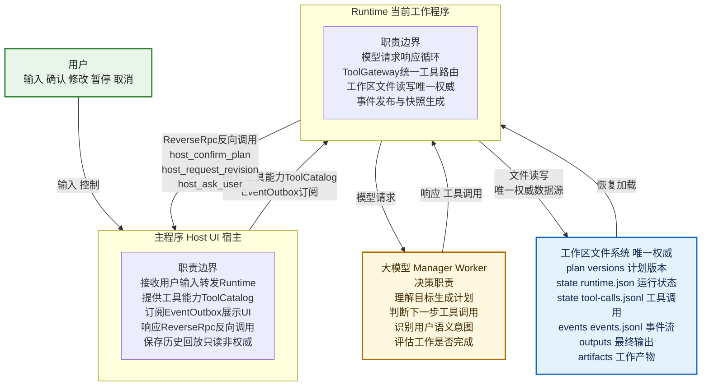

---

## 二、完整工作流程主流程

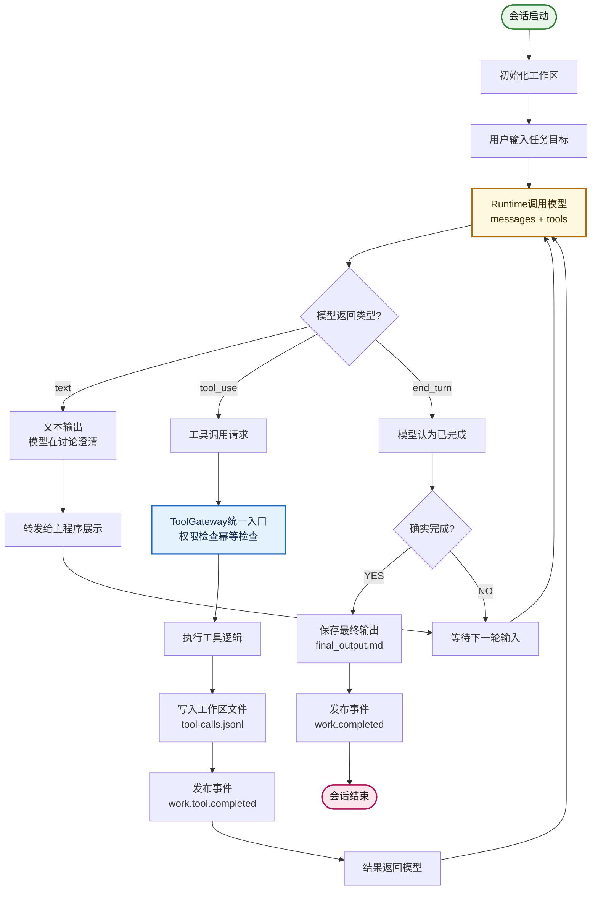

---

## 三、工具调用完整生命周期

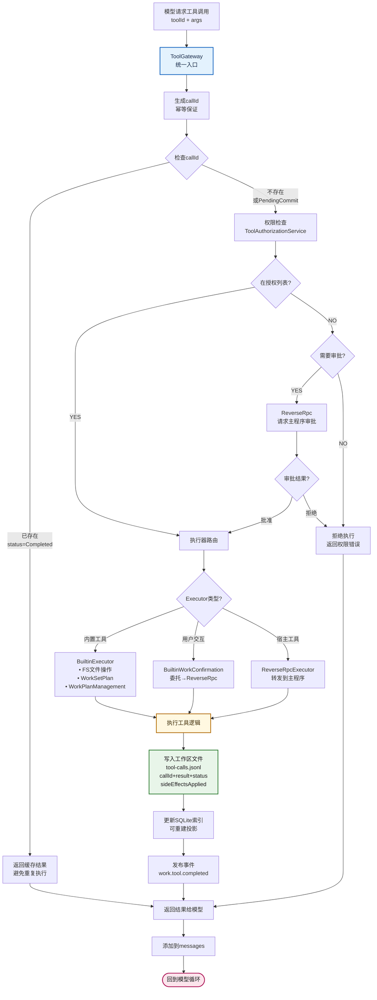

---

## 四、计划状态机完整视图

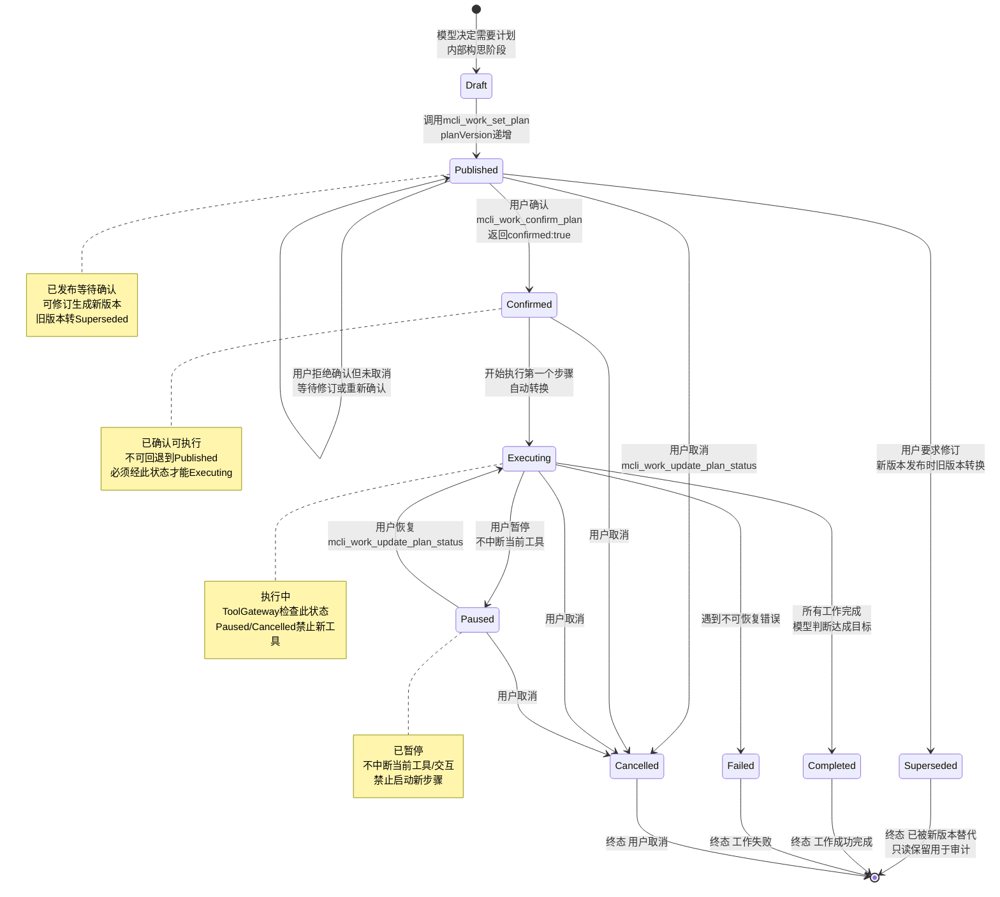

---

## 五、计划管理完整流程

```mermaid
flowchart TD
    SetPlan[模型调用mcli_work_set_plan<br/>goal+steps] --> ValidateData{验证数据格式?}
    
    ValidateData -->|goal非空<br/>steps有效| WritePlanFile[写入工作区文件<br/>plan/versions/{version}.json<br/>planVersion递增<br/>status: Published]
    ValidateData -->|无效| ErrorReturn[返回错误<br/>invalid_plan]
    
    WritePlanFile --> UpdateCurrent[更新current.json<br/>指向新版本]
    UpdateCurrent --> UpdateIndex[更新SQLite索引<br/>可重建投影]
    UpdateIndex --> PublishPlanEvent[发布事件<br/>work.plan.updated]
    PublishPlanEvent --> ReturnSuccess[返回成功<br/>planVersion+status]
    
    ReturnSuccess --> ModelWait[模型继续循环<br/>等待用户反馈]
    
    ModelWait --> UserAction{用户输入语义?}
    
    UserAction -->|确认/开始/可以| Confirm[模型识别确认<br/>调用mcli_work_confirm_plan]
    UserAction -->|修改/改成/调整| Revise[模型识别修订<br/>调用mcli_work_request_revision]
    UserAction -->|暂停/停一下| Pause[模型识别暂停<br/>调用mcli_work_update_plan_status<br/>newStatus: Paused]
    UserAction -->|取消/不做了| Cancel[模型识别取消<br/>调用mcli_work_update_plan_status<br/>newStatus: Cancelled]
    
    Confirm --> RpcConfirm[ReverseRpc:<br/>host_confirm_plan]
    RpcConfirm --> HostDialog[主程序展示确认对话框]
    HostDialog --> UserClick{用户操作?}
    
    UserClick -->|点击确认| ReturnConfirmed[返回confirmed:true]
    UserClick -->|拒绝/提意见| ReturnRejected[返回confirmed:false<br/>userInput: 意见]
    
    ReturnConfirmed --> UpdateConfirmed[更新状态: Confirmed<br/>写入confirmed_at]
    UpdateConfirmed --> EventConfirmed[发布事件<br/>work.plan.status_changed<br/>newStatus: Confirmed]
    EventConfirmed --> CanExecute[可以开始执行]
    
    ReturnRejected --> StayPublished[计划保持Published<br/>等待修订或取消]
    StayPublished --> ModelWait
    
    Revise --> RpcRevise[ReverseRpc:<br/>host_request_revision<br/>收集详细修改意见]
    RpcRevise --> HostRevisePanel[主程序展示修改面板<br/>富文本编辑器]
    HostRevisePanel --> ReturnRevision[返回newUserInput:<br/>详细修改意见]
    ReturnRevision --> ModelReplan[模型收到反馈<br/>重新调用set_plan<br/>新planVersion]
    ModelReplan --> SetPlan
    
    Pause --> UpdatePaused[更新状态: Paused<br/>禁止启动新步骤]
    UpdatePaused --> EventPaused[发布事件<br/>work.plan.status_changed]
    EventPaused --> WaitResume[等待用户决策]
    
    Cancel --> UpdateCancelled[更新状态: Cancelled<br/>使未完成交互失效]
    UpdateCancelled --> EventCancelled[发布事件<br/>work.plan.status_changed]
    EventCancelled --> WorkEnd([工作结束])
    
    CanExecute --> StartExec[模型开始执行<br/>调用第一个工具/步骤]
    StartExec --> AutoExecuting[计划状态自动更新:<br/>Executing<br/>写入started_at]
    AutoExecuting --> EventExecuting[发布事件<br/>work.plan.status_changed<br/>newStatus: Executing]
    
    style SetPlan fill:#FFF8E1,stroke:#B26A00,stroke-width:2px,color:#3E2A00
    style WritePlanFile fill:#E8F5E9,stroke:#2E7D32,stroke-width:2px,color:#1B1B1B
    style CanExecute fill:#E3F2FD,stroke:#1565C0,stroke-width:2px,color:#172B4D
    style WorkEnd fill:#FCE4EC,stroke:#AD1457,stroke-width:2px,color:#1B1B1B
```

---

## 六、用户语义识别机制（模型负责）

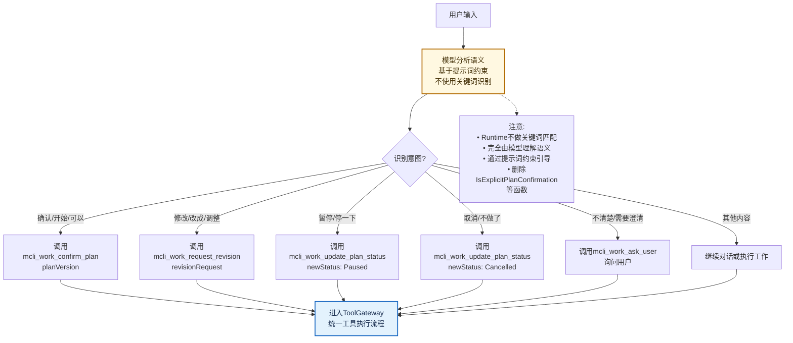

---

## 七、ReverseRpc 超时降级流程

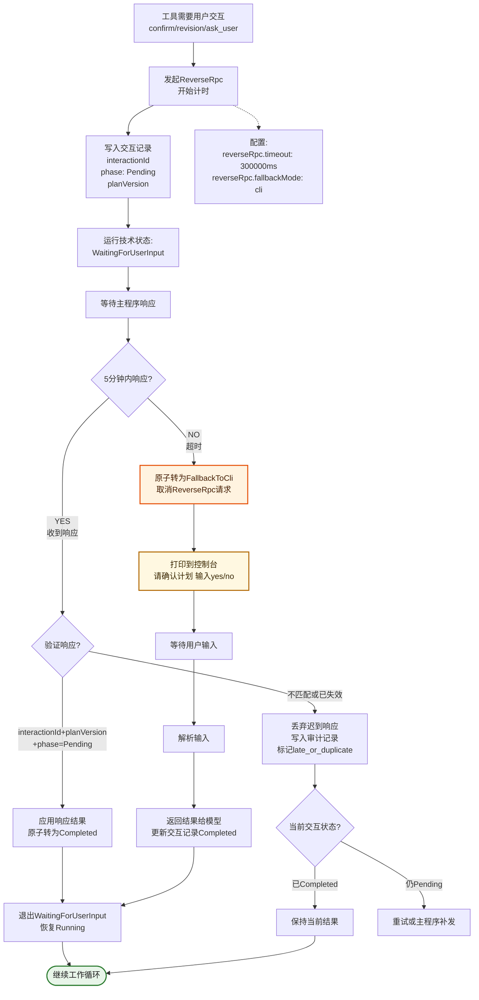

---

## 八、工具调用幂等重试流程

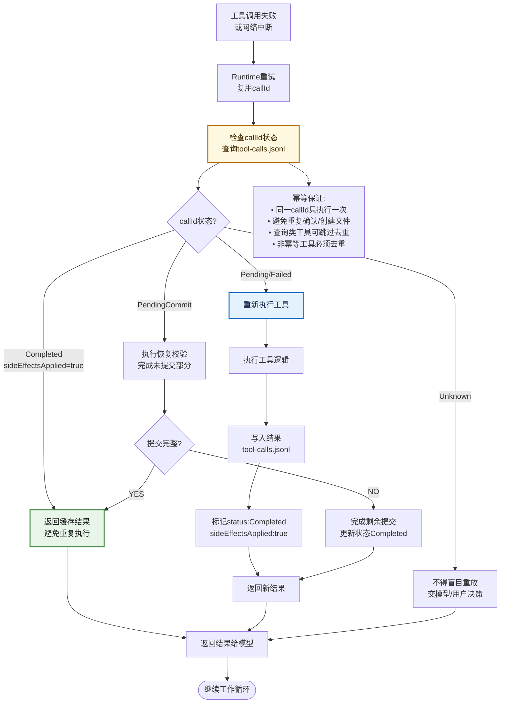

---

## 九、崩溃恢复流程

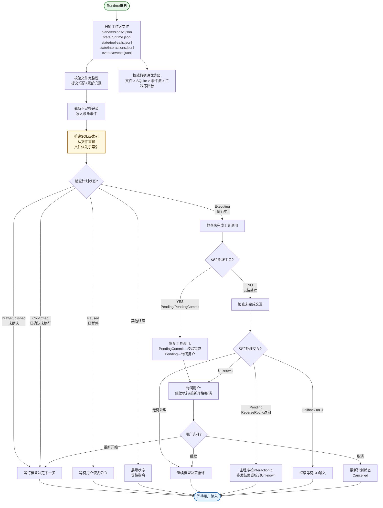

---

## 十、事件顺序性保证与快照恢复

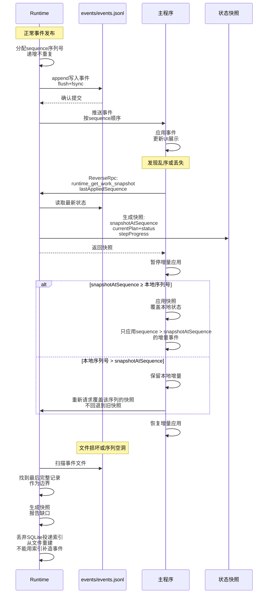

---

## 十一、会话技术状态机

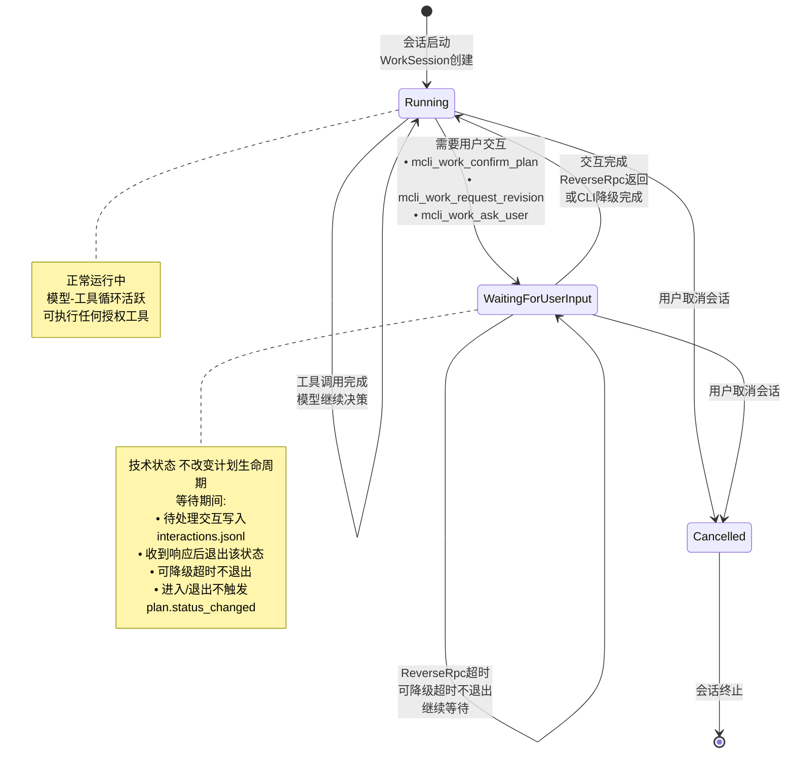

---

## 十二、数据一致性保证机制

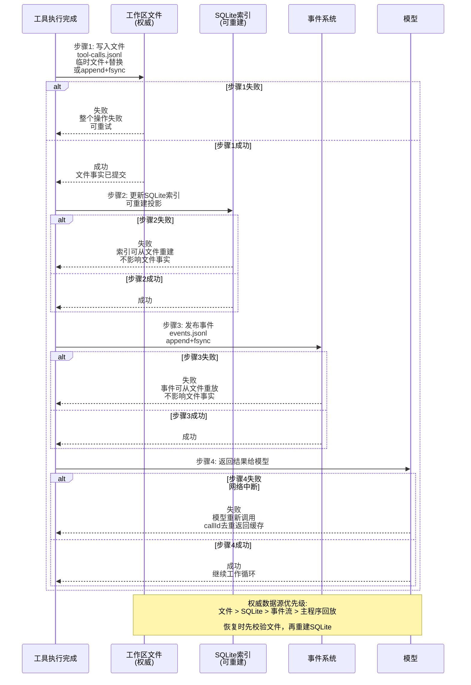

---

## 十三、完整时序图（所有组件协作）

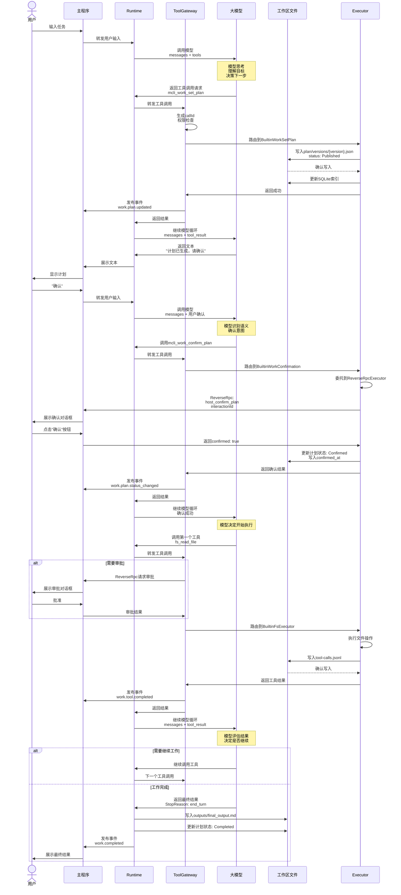

---

## 十四、工作模式对比

```mermaid
graph TB
    subgraph ModeA[模式A: 无计划直接执行<br/>简单任务 如读取文件]
        SA[WorkSession] --> TA1[ToolCall₁<br/>fs_read_file]
        TA1 --> TA2[ToolCall₂<br/>返回结果]
        TA2 --> DA[完成]
        
        Note1[特点:<br/>• 无需mcli_work_set_plan<br/>• 模型直接调用工具<br/>• 适用简单只读操作]
    end
    
    subgraph ModeB[模式B: 有计划无步骤细分<br/>模型生成计划但不细分步骤]
        SB[WorkSession] --> PB[Plan<br/>status: Published→Confirmed]
        PB --> TB1[ToolCall₁]
        TB1 --> TB2[ToolCall₂]
        TB2 --> TB3[ToolCall₃]
        TB3 --> DB[完成]
        
        Note2[特点:<br/>• 有goal和总体steps<br/>• 需要用户确认<br/>• 模型按计划逐步执行]
    end
    
    subgraph ModeC[模式C: 完整计划+步骤<br/>复杂任务 需要分步确认]
        SC[WorkSession] --> PC[Plan<br/>goal + 多个steps]
        PC --> SC1[Step₁<br/>分析代码]
        PC --> SC2[Step₂<br/>实施重构]
        PC --> SC3[Step₃<br/>验证结果]
        SC1 --> TC1[ToolCall₁-₅]
        SC2 --> TC2[ToolCall₆-₁₀]
        SC3 --> TC3[ToolCall₁₁-₁₅]
        TC3 --> DC[完成]
        
        Note3[特点:<br/>• 细分多个步骤<br/>• 每步有明确目标<br/>• 进度可追踪]
    end
    
    subgraph ModeD[模式D: Manager/Worker分层<br/>超大任务 可选配置]
        SD[WorkSession] --> PD[Plan<br/>Manager Agent]
        PD --> SD1[Step₁<br/>Worker Agent₁]
        PD --> SD2[Step₂<br/>Worker Agent₂]
        PD --> SD3[Step₃<br/>Worker Agent₃]
        SD1 --> TD1[ToolCalls]
        SD2 --> TD2[ToolCalls]
        SD3 --> TD3[ToolCalls]
        TD3 --> DD[完成]
        
        Note4[特点:<br/>• Manager生成计划<br/>• Worker执行步骤<br/>• 适用超大复杂任务]
    end
    
    style ModeA fill:#FFF8E1,stroke:#B26A00,stroke-width:2px,color:#3E2A00
    style ModeB fill:#E3F2FD,stroke:#1565C0,stroke-width:2px,color:#172B4D
    style ModeC fill:#E8F5E9,stroke:#2E7D32,stroke-width:2px,color:#1B1B1B
    style ModeD fill:#F3E5F5,stroke:#6A1B9A,stroke-width:2px,color:#311B46
```

---

## 十五、判断方法汇总

```mermaid
graph TB
    subgraph ModelDecisions[模型负责的决策]
        D1[是否需要生成计划?<br/>输入: 用户目标+任务复杂度<br/>输出: 调用set_plan或直接执行]
        
        D2[用户语义识别<br/>输入: 用户输入<br/>输出: 调用对应工具<br/>confirm/revision/pause/cancel]
        
        D6[是否继续工作?<br/>输入: 工具结果+当前进度<br/>输出: 继续调用工具或返回结果]
        
        D9[工作是否完成?<br/>输入: 所有步骤结果+用户目标<br/>输出: end_turn+最终答复]
    end
    
    subgraph RuntimeChecks[Runtime负责的技术检查]
        D3[计划是否可执行?<br/>输入: plan.json中status<br/>输出: Confirmed→可执行<br/>Published→禁止执行]
        
        D4[工具是否需要授权?<br/>输入: toolId+授权配置<br/>输出: 在列表→直接执行<br/>否则→审批]
        
        D5[工具调用是否重复?<br/>输入: callId+tool-calls.jsonl<br/>输出: Completed→返回缓存<br/>否则→执行]
        
        D7[是否暂停新工具?<br/>输入: plan.json中status<br/>输出: Paused/Cancelled→不启动<br/>Executing→允许]
        
        D8[ReverseRpc是否降级?<br/>输入: 调用开始时间+timeout<br/>输出: 超时→降级CLI<br/>未超时→等待]
    end
    
    D1 --> Model[模型负责业务决策]
    D2 --> Model
    D6 --> Model
    D9 --> Model
    
    D3 --> Runtime[Runtime负责技术检查]
    D4 --> Runtime
    D5 --> Runtime
    D7 --> Runtime
    D8 --> Runtime
    
    style ModelDecisions fill:#FFF8E1,stroke:#B26A00,stroke-width:2px,color:#3E2A00
    style RuntimeChecks fill:#E3F2FD,stroke:#1565C0,stroke-width:2px,color:#172B4D
```

---

## 核心设计要点总结

### 1. 职责清晰分离

| 角色 | 职责边界 | 不负责 |
|------|----------|--------|
| **模型** | • 理解目标生成计划<br/>• 判断下一步工具调用<br/>• 识别用户语义意图<br/>• 评估工作是否完成 | • 权限检查<br/>• 状态校验<br/>• 幂等保证<br/>• 文件持久化 |
| **Runtime** | • 模型请求/响应循环<br/>• ToolGateway统一路由<br/>• 状态转换校验<br/>• 工作区文件读写<br/>• 事件发布与快照 | • 业务决策<br/>• 计划拆分<br/>• 用户语义识别<br/>• 完成判断 |
| **主程序** | • 接收用户输入<br/>• 提供工具能力<br/>• 展示UI和事件<br/>• 保存历史回放 | • 创建/更新计划<br/>• 裁决执行状态<br/>• 模型调用循环 |

### 2. 数据权威唯一

```
工作区文件（唯一权威）
  ├── plan/versions/*.json       计划版本
  ├── state/runtime.json         运行状态
  ├── state/tool-calls.jsonl     工具调用
  ├── state/interactions.jsonl   用户交互
  ├── events/events.jsonl        事件流
  ├── outputs/                   最终输出
  └── artifacts/                 工作产物

SQLite（可重建索引）
  └── 仅保存查询投影和投递索引

恢复优先级: 文件 > SQLite > 事件流 > 主程序回放
```

### 3. 工具归一化

**删除旁路**：
- ❌ `WorkStepDispatchBridge.cs`
- ❌ `HandleDispatchStepAsync`
- ❌ `dispatch_step` 工具

**统一入口**：
```
所有工具调用 → ToolGateway
  ├── 1. 生成callId（幂等保证）
  ├── 2. 权限检查（ToolAuthorizationService）
  ├── 3. 审批流程（需要时ReverseRpc）
  ├── 4. 执行器路由（Builtin/ReverseRpc/Host）
  ├── 5. 结果记录（文件+索引）
  └── 6. 事件发布（work.tool.completed）
```

### 4. 状态分层管理

| 状态类型 | 管理者 | 持久化位置 | 作用 |
|----------|--------|------------|------|
| **计划生命周期** | Runtime | plan.json中status | Published/Confirmed/Executing/Paused/Completed/Failed/Cancelled |
| **运行技术状态** | Runtime | runtime.json | Running/WaitingForUserInput/Cancelled |
| **工具调用状态** | ToolGateway | tool-calls.jsonl | Pending/Executing/Completed/Failed/PendingCommit |
| **交互阶段** | Runtime | interactions.jsonl | Pending/ReverseRpcCompleted/FallbackToCli/Completed/Cancelled |

### 5. 异常处理机制

| 场景 | 处理策略 |
|------|----------|
| **工具调用失败** | callId去重，Completed直接返回缓存，避免重复执行 |
| **ReverseRpc超时** | 5分钟超时→原子转FallbackToCli→降级CLI交互 |
| **进程崩溃** | 扫描工作区文件→校验完整性→重建SQLite索引→恢复状态 |
| **事件乱序** | 主程序请求快照→按snapshotAtSequence合并→不回退到旧快照 |
| **状态冲突** | planVersion乐观锁→版本不匹配拒绝→返回最新状态 |

### 6. 用户语义识别

**删除关键词识别**：
- ❌ `IsExplicitPlanConfirmation`
- ❌ `IsPlanRevisionRequest`
- ❌ `IsPlanCancellation`

**模型理解语义**：
```
用户输入 → 模型分析语义（提示词约束）
  ├── "确认/开始/可以" → mcli_work_confirm_plan
  ├── "修改/改成/调整" → mcli_work_request_revision
  ├── "暂停/停一下" → mcli_work_update_plan_status(Paused)
  └── "取消/不做了" → mcli_work_update_plan_status(Cancelled)
```

---

## 配色方案说明

本文档使用的Mermaid配色方案与原参考文档保持一致：

- **浅绿色** `fill:#E8F5E9,stroke:#2E7D32` — 开始/完成/成功状态
- **浅蓝色** `fill:#E3F2FD,stroke:#1565C0` — Runtime核心组件/工具网关
- **浅黄色** `fill:#FFF8E1,stroke:#B26A00` — 模型决策/执行逻辑
- **浅粉色** `fill:#FCE4EC,stroke:#AD1457` — 结束/错误状态
- **浅橙色** `fill:#FFF3E0,stroke:#E65100` — 降级/异常处理
- **浅紫色** `fill:#F3E5F5,stroke:#6A1B9A` — Manager/Worker分层

---

## 文档评估结论

基于《工作模式架构重构策划.md》最新版本，本文档绘制了 **15 个核心流程图**，完整覆盖：

✅ **系统角色与职责边界** — 用户/主程序/Runtime/模型/工作区的职责划分  
✅ **完整工作流程** — 从会话启动到工作完成的主流程  
✅ **工具调用生命周期** — ToolGateway统一入口+权限+幂等+执行  
✅ **计划状态机** — 8个状态+合法转换规则+并发控制  
✅ **计划管理流程** — set_plan→confirm→revision→pause→cancel完整流程  
✅ **用户语义识别** — 模型理解语义+提示词约束+删除关键词识别  
✅ **ReverseRpc降级** — 5分钟超时+CLI降级+compare-and-set消费  
✅ **工具调用幂等** — callId去重+Completed缓存+PendingCommit恢复  
✅ **崩溃恢复流程** — 文件扫描+校验+重建索引+交互恢复  
✅ **事件顺序性** — sequence序列号+快照合并+不回退策略  
✅ **会话技术状态机** — Running/WaitingForUserInput/Cancelled  
✅ **数据一致性** — 文件优先+SQLite可重建+提交顺序  
✅ **完整时序图** — 所有组件协作的端到端流程  
✅ **工作模式对比** — 4种模式的适用场景  
✅ **判断方法汇总** — 模型决策vs Runtime检查

所有流程图与策划文档 **完全一致**，配色方案遵循原参考文档，可直接用于技术评审。