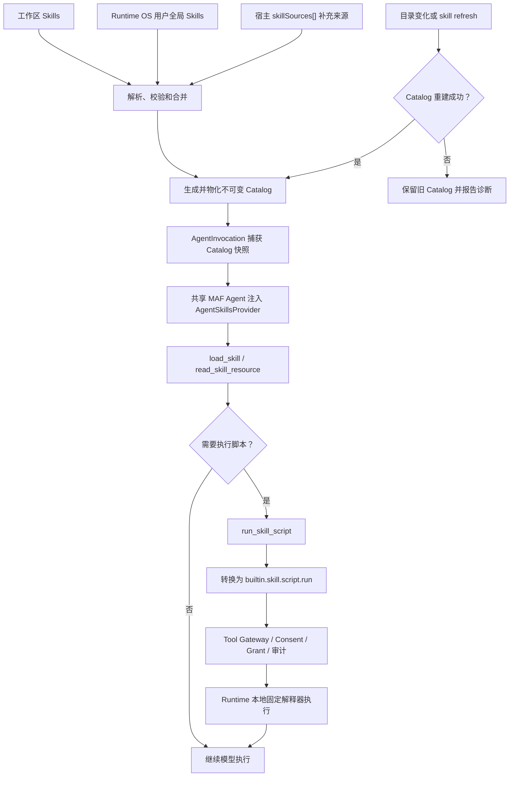

# 阶段 5A：Skills 加载与调用 : 主体实现完成，联合验收进行中

> 文档状态：执行中 · 阶段总进度：94.6%
>
> 设计依据：[Skills 加载与调用方案](../方案设计/05-Skills加载与调用方案.md)
>
> 执行位置：阶段 5 的 Tool Gateway 主链已可用后开始，必须在阶段 8 发布验收前完成。
>
> 当前范围：V1 只实现本地目录来源；`mcp` 来源仅冻结公开契约、能力协商和明确拒绝行为，不计入本阶段完成条件。

## 0. 进度跟踪

| 类别 | 已完成 | 总数 | 进度 |
| --- | ---: | ---: | ---: |
| 执行步骤 | 77 | 80 | 96.3% |
| 测试要求 | 20 | 22 | 90.9% |
| 完成标准 | 9 | 10 | 90% |
| 合计 | 106 | 112 | 94.6% |

| 子步骤 | 已完成 | 总数 | 进度 |
| --- | ---: | ---: | ---: |
| 4.1 冻结契约和接入边界 | 8 | 8 | 100% |
| 4.2 实现来源解析与初始化绑定 | 9 | 9 | 100% |
| 4.3 实现目录发现、校验与 Catalog | 11 | 11 | 100% |
| 4.4 接入 MAF 与 Invocation 快照 | 10 | 10 | 100% |
| 4.5 接入三种模式与工具权限边界 | 9 | 9 | 100% |
| 4.6 实现刷新、监听、诊断和事件 | 8 | 8 | 100% |
| 4.7 完成 CLI、Client SDK 与参考宿主 | 9 | 9 | 100% |
| 4.8 完成隔离、兼容和发布集成 | 5 | 8 | 62.5% |
| 11 V1 修订补充检查项 | 8 | 8 | 100% |

本阶段是横切专项，不重开已经归档的阶段 1、3、6B、6C 和 7。协议、持久化、模式与 Client SDK 的增量修改和回归测试统一在本文计数，完成后再进入阶段 8 联合验收。

阶段编号说明：当前没有阶段 5B，也没有预留阶段 5B。使用 `5A` 只是为了把本专项插入既有阶段 5 与阶段 6A 之间，同时保持原有阶段编号和归档链接稳定；以后只有出现范围独立、不能并入 5A 的新增专项时，才另行评审是否增加 5B。

## 1. 目标

- 独立 CLI 自动加载 `~/.madorin/skills/` 与 `<workspace>/.madorin/skills/`，工作区同名 Skill 稳定覆盖用户全局 Skill。
- 宿主通过初始化协议传入有序补充来源，Runtime 固定按工作区 → Runtime OS 用户全局 → 宿主来源合并，宿主不能覆盖自动来源。
- 建立框架无关、不可变、可版本化的 Effective Skills Catalog，并让每次 `AgentInvocation` 固定使用一个 Skills 快照。
- 通过 MAF 的渐进披露提供 `load_skill`、`read_skill_resource` 和 `run_skill_script`，不把全部 Skill 正文预先注入提示词。
- 专家、会议、工作模式和工作子 Agent 使用同一套 Catalog 与注入链。
- Skill 引用普通工具时继续经过现有 Tool Catalog、Consent、Tool Grant、Reverse RPC 和审计链。
- 提供可解释来源、覆盖、诊断和版本的 CLI、交互命令、Client SDK 与宿主操作面。
- 脚本首次哈希执行经 `builtin.skill.script.run` 进入 Consent/Grant/审计；脚本或解释器变化必须重新授权。

### 1.1 简化加载与调用流程

流程中的三个关键点：

1. 工作区来源始终优先；宿主来源继续按 `skillSources[]` 数组顺序处理。
2. `load_skill` 和 `read_skill_resource` 只读取当前快照内的内容，不进入普通 Tool Catalog。
3. `run_skill_script` 不直接启动未授权进程；它先进入内部 descriptor 和统一授权链，再由 Runtime 使用固定解释器执行物化副本。
4. Catalog 刷新成功后只影响下一次 `AgentInvocation`；正在执行的 Invocation 继续使用旧快照。

## 2. 前置门禁与范围

### 2.1 实施前置

实施人员必须先复核以下事实，不得按早期骨架状态推断当前代码：

1. 协议、Runtime 双通道、Invocation 持久化、三种模式、Client SDK 和参考宿主已具备正式实现，Skills 只能做增量接入。
2. 阶段 5 已建立版本化 Tool Catalog、权限、审批和反向 RPC 主链；Skills 不得创建第二套工具目录或授权链。
3. 当前中央包版本为 `Microsoft.Agents.AI` `1.7.0`；动工时先用最小编译测试再次确认 `AgentSkillsProvider`、`AgentFileSkillsSource` 和资源读取 API 的实际签名。
4. 修改公共协议前先冻结兼容规则、协议版本和 JSON Schema 变更；修改持久化快照前先冻结迁移与旧数据读取策略。
5. 阶段 2、4A、4B、5、6A 尚未完成的外部实机门禁不阻止本专项编码，但最终发布必须在阶段 8 合并验证。

### 2.2 实施前代码缺口（已关闭）

实施前基线只存在 `AgentRef.SkillIds` 占位字段，没有 `AgentSkillsProvider`、`SkillSource`、`skill.catalog.*` 或 Catalog 服务实现；`InitializeRequest`、`RuntimeCapabilities` 和 `InvocationSnapshot` 也缺少 Skills 契约。本轮已经补齐这些边界，并把具体 Provider 的 Agent 构建点收敛到共享 MAF 管线；框架无关上下文继续通过 `JsonIgnore` 字段传递，不向公共协议泄漏 MAF 类型。

`AgentRef.SkillIds` 在 V1 仅保留协议兼容，不代表逐 Agent 过滤或授权已经实现。V1 默认所有 Agent 可发现当前有效 Catalog；不得静默把该字段解释成 Tool Grant。

### 2.3 V1 范围边界

本阶段包含：本地文件型 Skills、远程来源协议预留、目录刷新、Catalog 查询、三模式接入、CLI/SDK 操作面、诊断、安全边界和发布门禁。

本阶段不包含：Skill 商店、安装/删除/更新、自动推荐、定时远程同步、签名或信任审批、逐 Agent Skills Profile、通用来源插件框架，以及远程 MCP Skills 的真实连接和下载。V1 本地脚本执行属于本阶段范围，但不提供 OS 沙箱。

## 3. 涉及项目

| 项目 | 本阶段职责 |
| --- | --- |
| `Madorin.AI.Runtime.Contracts` | 来源 DTO、能力协商、初始化结果、Catalog 查询/刷新消息、变更事件、错误码和 JSON 源生成 |
| `Madorin.AI.Runtime.Core` | 框架无关的来源、Skill 条目、Catalog、快照、合并和版本语义 |
| `Madorin.AI.Runtime.Entities` | `InvocationSnapshot` 的 Skills 版本、名称、哈希和来源字段 |
| `Madorin.AI.Runtime.Services` | 来源解析、目录发现、校验、Catalog 服务、监听刷新和 MAF Context Provider 工厂 |
| `Madorin.AI.Runtime.Server` | 初始化绑定、协议处理、实例生命周期和 Invocation 注入 |
| `Madorin.AI.Runtime.Modes.*` | 专家、会议参与者、工作总经理和子 Agent 的快照获取点 |
| `Madorin.AI.Runtime.Cli` | 默认目录解析、`skill` 命令、REPL 斜杠命令、Doctor 和统一输出 |
| `Madorin.AI.Runtime.Client` | 初始化来源、Catalog 查询和刷新 API |
| `Madorin.AI.Runtime.SampleHost` | 显式宿主来源传入及查询/刷新示例 |
| 现有测试项目 | 协议、Catalog、Provider、模式、持久化、CLI、并发和端到端门禁 |

不新建独立 Skills 程序集。MAF 类型只能存在于实现层，不得进入 `Contracts`、`Core`、`Entities` 或公共 Provider 抽象。

## 4. 执行步骤 : 96.3%

### 4.1 冻结契约和接入边界 : 100%

- [√] 形成协议变更清单，明确新增字段的可空/默认值、旧 Client/Runtime 组合行为、目标协议版本和回退点。
- [√] 定义有序 `SkillSourceDescriptor` 及 `SkillSourceKind`，最小字段固定为 `sourceId`、`kind`、`location`，`sourceId` 在单次初始化内唯一。
- [√] 定义 `SkillsCapabilities`，公开 `enabled`、`sourceKinds`、`resourcesSupported`、`scriptsSupported`、`hotRefreshSupported`，当前只宣告 `directory`。
- [√] 定义初始化来源结果、Catalog 摘要、有效条目、被覆盖条目和结构化诊断 DTO；初始化响应不返回完整 Skill 正文。
- [√] 定义 `skill.catalog.get`、`skill.catalog.refresh` 和 `skill.catalog.changed` 的请求、响应与事件契约，并保持实例绑定路由。
- [√] 增加全部稳定错误码，覆盖来源类型不支持、显式来源不存在/不可用、定义非法、来源内重复、资源阻止、解释器不可用、脚本授权和刷新失败。
- [√] 把新增协议类型加入 `RuntimeJsonContext`、JSON Schema 和协议快照测试，确认路径、中文、URL 和首尾空白无损往返。
- [√] 完成当前 Provider Agent 构建点的编译型接入验证，冻结一个框架无关的 Invocation 上下文交接方式；所有支持的 Provider 必须获得一致 Skills 语义或返回明确能力错误，禁止 MAF 类型进入公共 Provider 抽象、`Contracts` 或 `Core`。

### 4.2 实现来源解析与初始化绑定 : 100%

- [√] 实现 `SkillSourceResolver`，只负责把 Runtime 自动来源与调用方来源组装为稳定有序列表，不承担目录扫描和内容校验。
- [√] 独立 CLI 使用显式工作区；未指定时使用当前目录的规范化绝对路径，并组装 `[workspace, user-global]`。
- [√] 宿主模式根据 Runtime 已绑定工作区组装 `[workspace, user-global] + initialize.skillSources`，不得让宿主重复指定或替换两个自动来源。
- [√] 宿主自动读取 Runtime OS 用户的 `~/.madorin/skills/`；宿主来源只补充且严格保持数组顺序，不按来源类型重排。
- [√] 为自动工作区和用户全局来源使用稳定内部 `sourceId`，同时保留调用方原始 `location` 和用于访问的规范化副本。
- [√] 路径规范化覆盖相对路径拒绝、空格、中文、大小写、尾分隔符、UNC 和平台根目录语义；URL 校验保留原始请求语义并为日志生成脱敏值。
- [√] 缺失的自动约定目录返回 `empty`；宿主显式目录不存在、不可读或格式错误时初始化失败，不得降级为静默空来源。
- [√] 初始化时拒绝重复 `sourceId`；当前收到 `kind = mcp` 时返回 `SkillSourceKindNotSupported` 和实际能力，不得忽略或尝试半连接。
- [√] 每个 Runtime 实例独立持有解析后的来源列表；初始化成功前完成首次 Catalog 构建并原子发布，失败不得留下半初始化来源或监听器。

### 4.3 实现目录发现、校验与 Catalog : 100%

- [√] 实现 `SkillCatalogService`，集中承载发现、校验、合并、内容哈希、版本化和原子读取，不把可变集合暴露给调用方。
- [√] 只把直接 Skill 子目录中的固定名称 `SKILL.md` 作为入口，以 UTF-8 读取并解析 YAML Frontmatter 和 Markdown 正文。
- [√] 校验 `name`、`description`、kebab-case、目录名一致性和 MAF 兼容字段；单个非法 Skill 被跳过并产生稳定诊断，其他有效 Skill 继续加载。
- [√] 集中配置单文件大小、单 Skill 文件数、单 Skill 总字节数、Catalog 总条目数和单次读取量上限，超限时 fail closed 并给出具体诊断。
- [√] 建立资源扩展名允许列表，并通过最终路径、符号链接和目录联接点检查阻止 `..` 或链接逃逸 Skill 根目录；未知二进制不进入模型上下文。
- [√] 对正文、Frontmatter 和可读资源生成稳定内容哈希；哈希不得包含机器相关的绝对目录前缀或不稳定枚举顺序。
- [√] 同一来源内出现大小写等价名称时返回 `SkillDuplicateInSource`，冲突条目均不生效，不依赖文件系统枚举顺序随机选择。
- [√] 跨来源按“越靠前越优先”及不区分大小写名称合并，工作区稳定覆盖全局，宿主来源严格按数组顺序覆盖后续来源。
- [√] 为胜出条目记录名称、描述、来源、顺序、内容哈希和 Catalog 版本；为未胜出条目记录 `shadowed` 及胜出来源。
- [√] 只有有效集合、来源状态或 Skill 内容哈希发生变化时才生成新 `skillCatalogVersion`；重复扫描相同内容不得制造新版本。
- [√] 识别六类 MAF 默认脚本扩展名，绑定固定解释器并报告缺失；正文和资源仍进入 Catalog，脚本通过内部 descriptor 注册到 Gateway 而不进入公共 Tool Catalog。

### 4.4 接入 MAF 与 Invocation 快照 : 100%

- [√] 用锁定的 MAF 版本建立最小编译和行为测试，确认文件来源、多来源顺序、正文加载、资源读取、缓存和 Provider 释放 API，不照抄其他版本示例。
- [√] 实现 `SkillContextProviderFactory`，只接受不可变 Catalog 快照，并为一次 Invocation 创建对应的 `AgentFileSkillsSource` 与 `AgentSkillsProvider`。
- [√] 每个 Invocation 独立持有并释放 Context Provider；同版本 Invocation 可以共享不可变 Catalog 数据，但不得共享会被刷新修改的 Provider 状态。
- [√] 按 4.1 冻结的接入边界，把 Skills Context 注入实际 `ChatClientAgentOptions.AIContextProviders` 构建点；未走该 Agent 管线的 Provider 必须先接入共同构建链或返回明确能力错误，禁止静默宣告 Skills 已启用。
- [√] 验证初始上下文只暴露有效 Skill 的名称、描述和加载说明，未选择 Skill 时不得读取或拼接完整正文。
- [√] 启用 `load_skill`、`read_skill_resource` 和 `run_skill_script`；脚本回调转换为 `builtin.skill.script.run`，进入 Consent/Grant/审计，内部 descriptor 不进入宿主 Tool Catalog。
- [√] 扩展 `InvocationSnapshot`，记录 `skillCatalogVersion`、有效 Skill 名称与哈希、来源 ID，并采用不可变、确定顺序的数据结构。
- [√] 更新 Snapshot 的 JSONL、数据库或其他现有持久化读写边界和源生成元数据；旧记录缺少 Skills 字段时按“历史版本未知”读取，不伪造当前版本。
- [√] 在 Invocation 创建安全点同时固定 Selection、Prompt、Memory、Tool Catalog、ContextProjection 和 Skills 快照，并保证诊断查询返回实际使用值。
- [√] 目录变化或刷新期间，已经开始的 Invocation 始终持有旧 Catalog；刷新成功后只有下一次真正创建的 Invocation 使用新版本。

### 4.5 接入三种模式与工具权限边界 : 100%

- [√] 专家模式在每次专家 `AgentInvocation` 创建时获取 Skills 快照，续接 Session 或切换 Agent/Provider/模型时不复用上一 Invocation 的可变 Provider。
- [√] 会议模式为每位参与者、动态加入参与者及摘要 Agent 的每次实际发言分别固定快照，不在整场会议开始时共享一个可变 Provider。
- [√] 工作模式总经理在计划、修订和继续执行形成的新 Invocation 中分别获取快照，状态机重试不得误用其他 Agent 的 Provider。
- [√] 每个工作子 Agent 在步骤真正开始时获取快照；子 Agent 可以发现相同有效 Skills，但不继承父 Agent 的 Tool Grant。
- [√] 崩溃恢复和 Resume 明确区分历史 Invocation 元数据与新 Invocation：历史记录保留原版本/哈希，恢复后新建 Invocation 使用恢复时的当前 Catalog。
- [√] 固定提示词组装顺序为 Runtime 指令、Agent 指令、全局 Memory、项目 Memory、Skills 摘要、历史投影和本轮输入；Skill 正文继续按需加载。
- [√] `AgentRef.SkillIds` 在 V1 只作兼容透传和保留字段，不参与可见性、过滤或授权；对外文档和诊断不得宣称其已生效。
- [√] `allowed-tools` 只用于 `skill validate` 的能力提示，不能新增 Tool Catalog 条目、生成 Grant、自动批准或扩大委派范围。
- [√] Skill 引发的普通工具调用完整经过现有 Tool Gateway、Consent、Reverse RPC、幂等和审计链；工具缺失或权限拒绝必须返回 Agent，不能降级到内部直接执行。

### 4.6 实现刷新、监听、诊断和事件 : 100%

- [√] Runtime 启动完成首次加载后，为本实例的工作区和显式目录来源建立独立文件监听器，只观察 `SKILL.md` 和允许的附属资源变化。
- [√] 对创建、修改、删除、重命名和批量写入使用有界短防抖，只把 Catalog 标记为过期，不在监听回调中替换进行中的 Invocation。
- [√] 下一 Invocation 开始前若 Catalog 过期，则通过与首次加载相同的单飞重建流程刷新；并发 Invocation 不得重复启动无界扫描。
- [√] `skill refresh`、REPL 刷新和宿主刷新 RPC 复用同一重建入口，并返回旧版本、新版本、来源结果和诊断。
- [√] 刷新成功后原子替换当前 Catalog；刷新失败保留旧 Catalog 和监听能力，返回 `SkillRefreshFailed`，下一 Invocation 继续使用旧版本。
- [√] 正确处理来源目录删除、重新创建、监听器溢出和 Runtime 释放；一个实例的监听失败不得影响其他实例。
- [√] 结构化诊断包含 Runtime/工作区/Catalog/来源/Skill/操作/耗时/结果和错误码，默认不记录正文、资源内容、敏感工具参数或带查询凭据的 URL。
- [√] 仅在 Catalog 成功发生语义变化时发送 `skill.catalog.changed`，事件包含旧/新版本、有效数量和变更名称摘要，并按 `runtimeInstanceId` 路由。

### 4.7 完成 CLI、Client SDK 与参考宿主 : 100%

- [√] 在现有命令树增加 `madorin skill list/show/validate/refresh`，统一使用既有输出、退出码、取消和异常映射机制。
- [√] `skill list [--scope effective|workspace|global]` 输出名称、描述、来源、状态和覆盖关系，不输出完整正文。
- [√] `skill show <name> [--scope ...]` 输出解析后的 Frontmatter、来源、正文和资源清单，但不读取未知二进制、不执行脚本。
- [√] `skill validate [--scope ...]` 检查目录、Frontmatter、重复名称、资源边界、技术上限、工具缺失、脚本扩展名和解释器可用性，并区分错误与提示；不执行脚本。
- [√] `skill refresh` 只刷新当前实例的既有来源集合；不得安装、修改 Skill 或在运行中替换来源数组。
- [√] 为四个命令补齐人类可读和 `--json` 输出、命令帮助、JSON Schema/快照、稳定退出码及特殊字符往返测试。
- [√] 在现有 REPL 增加 `/skill list`、`/skill show <name>`、`/skill refresh`，直接操作当前本地 Runtime，不启动第二进程。
- [√] Client SDK 支持初始化时传入有序来源数组，并提供 Catalog 查询和刷新 API；来源集合变更必须通过新 Runtime 实例完成。
- [√] SampleHost 演示显式全局目录传入、Catalog 查询和刷新；Doctor 与诊断包显示能力、来源状态、版本和限制，但不泄露正文或凭据。

### 4.8 完成隔离、兼容和发布集成 : 62.5%

- [√] 验证多个 Runtime 进程可并发读取同一全局目录，不建立进程全局 Catalog、静态当前工作区或不必要的跨进程读锁。
- [√] 验证多宿主、多 Runtime、多工作区具有独立来源数组、版本、监听器和结果；任一实例刷新或失败不影响其他实例。
- [×] 覆盖 Windows、Linux、macOS 的主目录与工作区解析，以及空格、中文、前导数字、长路径、UNC、符号链接和目录联接点边界。
- [√] 验证全部 Skills 操作默认为只读，不创建缺失默认目录，不提供 install/remove/update/search，也不写回私有清单。
- [√] 冻结远程扩展边界：当前 `mcp` 明确能力不足；以后启用远程来源时复用同一 DTO、Catalog、快照和合并链，不修改宿主请求形状。
- [√] 完成新旧协议组合、旧 Invocation 数据、未知新增字段和能力降级测试；不兼容组合必须在初始化阶段失败并给出稳定错误。
- [×] 记录目录规模、Catalog 重建、Invocation 创建和资源读取的性能/内存基线，验证集中上限、取消和超时不会产生无界任务或缓存。
- [×] 完成 Debug/Release、全量测试和 Native AOT 发布；保持 0 警告、0 trimming/AOT 警告，并把 Skills 结果纳入阶段 8 发布清单。

## 5. 测试要求 : 72.7%

- [√] 协议快照覆盖来源 DTO、Skills 能力、初始化结果、Catalog 查询/刷新、变更事件和全部错误码，并验证目标协议版本的兼容矩阵。
- [√] 独立模式覆盖两个默认目录均不存在、仅全局存在、仅工作区存在和二者同时存在，缺失默认目录均正常启动且不被创建。
- [√] 宿主模式覆盖零个、一个和多个显式目录，验证工作区、Runtime OS 用户全局目录在前，宿主数组顺序稳定且补充来源不能覆盖自动来源。
- [×] 路径与 URL 覆盖空格、中文、前导数字、首尾空白、编码路径、查询参数、UNC 和不同平台主目录，诊断日志不泄露查询凭据。
- [√] 无效定义覆盖入口缺失、非 UTF-8、Frontmatter 缺失/错误、名称非法、目录名不一致和不可读文件，其他有效 Skill 不受影响。
- [√] 来源内重复覆盖大小写变体和不稳定文件枚举，验证冲突条目均不生效并返回 `SkillDuplicateInSource`。
- [√] 跨来源合并覆盖工作区与全局同名、多个宿主来源同名和内容相同但路径不同，验证胜出项、`shadowed` 诊断和哈希稳定。
- [√] 资源安全覆盖 `..`、绝对路径、符号链接、目录联接点、竞态替换、未知二进制和允许扩展名，所有逃逸读取均 fail closed。
- [√] 技术上限覆盖超大正文、资源数量、总字节数、Catalog 条目数、取消和并发读取，验证无界内存、任务和文件句柄不会增长。
- [√] 渐进披露验证未选择 Skill 时不读取正文，选择后 `load_skill` 返回正确指令，引用资源时 `read_skill_resource` 只返回快照内允许内容。
- [√] 工具边界覆盖工具不存在、宿主允许、宿主拒绝、独立交互 Consent、非交互 fail closed 和 `allowed-tools` 声明，均不得形成旁路授权。
- [√] 脚本目录覆盖 PowerShell、Shell、Python、Node、C# 和 CSX，验证正文仍可加载、解释器缺失可诊断、脚本执行经过内部 descriptor 和授权链。
- [√] Invocation 运行中修改 Skill 并刷新，验证当前调用的名称、哈希、正文和资源不变，下一 Invocation 使用新版本。
- [√] 监听与刷新覆盖批量写入、防抖、目录删除/重建、监听器溢出和来源暂时不可读，失败时保留旧 Catalog。
- [√] 专家模式覆盖新建、续接、切换 Agent/Provider/模型和工具调用，查询到的实际 Skills 快照与执行一致。
- [√] 会议模式覆盖多参与者、动态参与者、摘要、恢复和并发发言，各 Invocation 快照独立且不串用工具权限。
- [√] 工作模式覆盖总经理、计划修订、子 Agent、重试、恢复和并行步骤，各 Invocation 使用开始时版本且子 Agent 不继承 Grant。
- [√] 端到端覆盖 CLI/REPL、Client SDK、SampleHost、多宿主、多 Runtime、不同工作区、当前 `mcp` 拒绝、Debug/Release 和 Native AOT。
- [×] 六类脚本分别覆盖真实成功、解释器缺失、参数数组和中文路径，验证固定命令形状且不经过 Shell 字符串拼接。
- [√] 脚本进程覆盖超时、调用方取消、进程树清理、stdout/stderr 共享输出上限和非零退出码。
- [√] 脚本授权覆盖允许、拒绝、宿主断线、独立非交互 fail closed、同 Run 哈希复用及脚本变化后重新审批。
- [√] 验证 `builtin.skill.script.run` 不出现在模型公共工具目录，且执行记录关联 ToolIntent、Grant、Invocation 和审计。

## 6. 完成标准 : 90%

- [√] 直接启动 `madorin` 可自动加载用户全局和工作区目录，两个目录不存在时仍正常运行且不产生写操作。
- [√] 宿主只需传额外有序来源，Runtime 自动绑定工作区和 Runtime OS 用户全局来源，补充来源不覆盖自动来源。
- [√] 来源内冲突、跨来源覆盖、来源状态和版本变化均确定且可解释，不依赖文件系统或 DI 枚举顺序。
- [√] 模型通过 MAF 渐进披露读取正文和资源，未选中的 Skill 不把完整内容注入初始提示词。
- [√] Skills 上下文操作与普通工具完全分离；普通工具仍经过统一目录、权限、审批、Reverse RPC、幂等和审计。
- [√] 专家、会议、工作总经理和工作子 Agent 均固定不可变 Invocation 快照，当前调用不被刷新污染。
- [√] 文件变化和显式刷新只影响后续 Invocation，刷新失败保留旧 Catalog 并产生可查询诊断。
- [√] CLI、REPL、Client SDK、SampleHost 和 Doctor 能解释来源、覆盖、诊断和实际版本，且不会泄露正文、资源或凭据。
- [√] 当前远程来源返回明确能力错误，`allowed-tools` 不授权，Skill 脚本不存在直接执行路径，Runtime 不增加信任审批。
- [×] 协议、单元、集成、模式、端到端、并发、跨平台和 Native AOT 门禁全部通过并形成验收记录。

## 7. 建议执行批次

| 批次 | 内容 | 进入条件 | 出口条件 |
| --- | --- | --- | --- |
| A | 4.1 契约边界 + 4.2 来源解析 | 协议与接入点评审完成 | Fake Host 和独立解析器得到相同有序来源语义 |
| B | 4.3 Catalog + 4.4 MAF/快照 | A 的协议快照通过 | 单一 Invocation 可渐进加载且快照可查询 |
| C | 4.5 三模式 + 4.6 刷新诊断 | B 的 Provider 测试通过 | 三模式和并发 Invocation 不串版本或权限 |
| D | 4.7 操作面 + 4.8 发布集成 | C 的模式测试通过 | 112 个检查项全部完成并并入阶段 8 |

每批先补失败用例和快照，再实现业务代码。协议、Schema 或持久化格式发生变化时，先提交独立兼容变更；Git 提交说明使用中文。

## 8. 后续远程来源触发条件

真实 `mcp` 来源不属于本阶段。只有同时满足以下条件后，才能另建加法专项：

1. 包含远程 Skills 的正式 MAF NuGet 版本进入依赖基线，并通过 Native AOT 与许可证评估。
2. `Microsoft.Agents.AI.Mcp`、`AgentMcpSkillsSource`、`UseMcpSkills` 和 `skill://index.json` 的实际 API 已用最小项目验证。
3. 远程认证、URL 脱敏、实例级缓存/解压目录和连接释放策略已经冻结。
4. 新实现复用本文的来源 DTO、Catalog、快照、刷新、工具边界和多实例规则，不修改宿主初始化请求形状。

后续专项不得顺带引入商店、签名系统、定时同步、自动安装或跨实例共享下载服务。

## 9. 本轮验收记录

| 项目 | 结果 |
| --- | --- |
| 构建号 / Commit | 工作树基于 `52a0dd3f890b1b008b39ea75299db58aa0ac76d6`，Skills 变更尚未提交 |
| 协议版本 | `1.1`；缺少 `skillSources` 的旧 Client 按空数组兼容 |
| 数据库 / Snapshot 版本 | SQLite Schema v8；`InvocationSnapshot` Skills 字段可空，旧记录按未知版本读取 |
| 定向测试 | Provider 全项目 Windows 通过；Linux Provider `283 passed / 2 failed / 11 skipped`，失败均为 WSL 未安装 `pwsh`；Modes 全项目通过；Skills CLI、Doctor、REPL 直接相关 E2E 通过 |
| Debug / Release | 最新全解决方案 Debug、Release 均成功，`0 warnings / 0 errors` |
| 全量测试 | Windows Debug `1070 passed / 9 skipped / 0 failed`；Windows Release `1070 passed / 9 skipped / 0 failed`；Linux ext4 E2E `321 passed / 8 skipped / 0 failed`；Linux Provider 的 2 个失败仅为 `pwsh` 缺失环境前置条件 |
| Native AOT | 最新 Windows `win-x64` 成功且无 trimming/AOT 警告；原生可执行文件 `--version` 冒烟通过，输出协议版本 `1.1` |
| 跨平台发布 | `linux-x64`、`linux-arm64`、`osx-x64`、`osx-arm64` 已完成框架依赖发布编译；Linux x64 已在 ext4 实机路径运行，macOS 和其余 RID 实机仍待验证 |
| 性能基线 | 已完成事件压力和取消确认回归；尚未形成 P50/P95/P99、长稳态和机器规格归档 |
| 未关闭风险 | 5 项：macOS/全 RID 实机路径矩阵、性能统计归档、全 RID Native AOT/发布门禁、六类解释器真实成功矩阵、真实 Provider 冒烟 |
| 回退点 | Git 基线 `52a0dd3f890b1b008b39ea75299db58aa0ac76d6`；Catalog/Skills 字段均为向后兼容可选增量 |

## 10. 风险与禁止事项

- 不得因来源由宿主或用户提供而跳过格式、资源边界、大小限制和错误报告；这些是稳定性边界，不是信任审批。
- 不得增加 `SkillUntrusted`、签名要求、白名单或二次人工确认；宿主和独立用户是来源信任权威。
- 不得把来源数组拼成命令行字符串，也不得把远程 Token 放进 `location` 或普通日志。
- 不得让宿主传入第二个工作区 Skills 路径并覆盖 Runtime 的绑定工作区。
- 不得把完整 Skill 正文预先拼入系统提示词或 Memory，也不得把加载结果写回项目文件。
- 不得把 `load_skill`、`read_skill_resource` 混入宿主 Tool Catalog 或占用宿主业务工具名称空间。
- 不得让 `allowed-tools`、`AgentRef.SkillIds` 或 Skill 正文创建工具、授予权限或绕过 Tool Gateway。
- 不得启用 MAF 自带 Script Approval 或绕过 Runtime Gateway 直接启动 Skill 脚本；唯一执行路径是固定解释器和内部 descriptor。
- 不得用字符串前缀检查代替最终路径、符号链接和目录联接点边界验证。
- 不得使用进程静态 Catalog、全局当前工作区、跨实例可变 Provider 或共享可清理缓存。
- 不得在当前 MAF 版本不支持远程来源时静默忽略 `mcp`，也不得提前把远程能力标记为已启用。
- 不得在 112 个检查项未全部完成前把阶段标记为已完成或进入阶段 8 的 Skills 发布验收。

## 11. V1 修订补充检查项 : 100%

以下 8 个执行检查项计入新的 112 项总数，并在联合验收中逐项记录：

- [√] Catalog 物化副本按 Runtime 实例隔离；刷新成功原子发布，刷新失败保留旧版本。
- [√] 运行中的 Invocation 固定使用启动时的 Catalog 版本、脚本路径和内容哈希。
- [√] `.ps1/.sh/.py/.js/.cs/.csx` 分别使用固定解释器；解释器不存在返回 `SkillScriptInterpreterUnavailable`。
- [√] 参数以数组传递，工作目录固定为绑定工作区，环境变量只使用现有允许列表，不注入 Provider 凭据。
- [√] `builtin.skill.script.run` 只存在于 Gateway 授权快照，不出现在模型公共工具列表。
- [√] Script Grant 记录 Skill、脚本内容哈希、解释器和 Catalog 版本；同一 Run 仅复用相同键，脚本变化后重新 Consent。
- [√] Reverse RPC 宿主断线、独立 CLI 非交互和拒绝响应均 fail closed；每次执行具有关联的 ToolIntent、Grant、Invocation 和审计记录。
- [√] 脚本执行复用现有超时、取消、进程树清理、输出上限、幂等记录和审计设施；非零退出码保留结构化结果。
